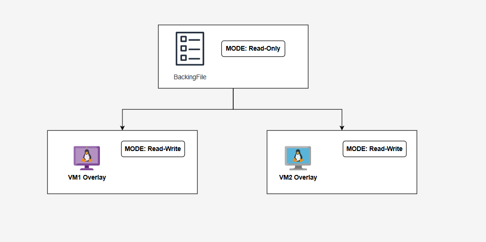

# Templates trong KVM
## Khái niệm
VM template là một khuôn mẫu được chuẩn bị sẵn của một máy ảo (VM). Nó bao gồm hệ điều hành, các ứng dụng, cấu hình mạng và các thiết lập khác đã được người dùng cài, được dùng làm cơ sở để tạo nhanh các máy ảo mới.

Thay vì phải cài đặt và cấu hình thủ công từng máy ảo từ đầu, người dùng có thể sử dụng một *template* để sao chép hàng loạt các máy ảo giống hệt nhau. Điều này giúp tiết kiệm thời gian, đảm bảo tính nhất quán và giảm thiểu sai sót trong quá trình triển khai.

## Đặc điểm
Tính Tổng quát hóa (Generalization)

- Đã được làm sạch toàn bộ dữ liệu định danh duy nhất (Unique Identifiers) như /etc/machine-id, SSH Host Keys, udev persistent network rules và DHCP leases bằng các công cụ chuyên dụng như virt-sysprep
- Đảm bảo khi nhân bản ra hàng loạt máy ảo con, các VM này sẽ không bị đụng độ địa chỉ IP, trùng MAC address hay lỗi giao tiếp mạng

Chế độ Chỉ đọc và Bất biến (Read-Only & Immutability)
- File đĩa đệm của Template (thường dạng `.qcow2`) luôn được phân quyền chỉ đọc
- Không tiến trình QEMU nào được phép ghi dữ liệu trực tiếp vào file này, bảo vệ bộ đĩa gốc khỏi nguy cơ hỏng hóc hoặc sai lệch cấu hình.

Đóng vai trò làm Đĩa gốc
- Phục vụ trực tiếp cho cơ chế Copy-on-Write (CoW).
- Nhiều máy ảo con (Linked Clones) có thể dùng chung một file Template làm gốc. Các dữ liệu phát sinh mới của từng VM con sẽ được ghi vào file đĩa tầng trên mà không làm ảnh hưởng tới Template

Đã tích hợp và đóng gói sẵn (Pre-configured Package)
- Đã cài đặt hoàn chỉnh OS, các bản vá bảo mật, driver ảo hóa (VirtIO drivers), QEMU Guest Agent và các phần mềm ứng dụng nền tảng (như Docker, Nginx...)
- Rút ngắn thời gian cấp phát máy ảo mới từ 15–30 phút xuống chỉ còn vài giây.

Tách biệt khỏi Trạng thái Máy ảo (Stateless / Image-only)

- Template chỉ tồn tại dưới dạng một file đĩa mẫu tĩnh nằm trong Storage Pool, không liên kết cố định với cấu hình máy ảo XML nào và không có tiến trình QEMU chạy ngầm
- Khi đặt trên NFS Server, tất cả các KVM Host trong cụm đều có thể truy cập và khởi tạo VM con từ chung một Template này

## VM Clone vs VM Templates
VM Clone là bản sao trực tiếp từ một máy ảo cụ thể đang tồn tại, trong khi VM Template là một file đĩa mẫu tĩnh đã được dọn dẹp sạch dữ liệu định danh (Generalization/Sysprep) để dùng làm chuẩn tạo hàng loạt máy ảo mới.

VM Clone sẽ như 1 bản Snapshot của VM, sao chép y nguyên và tạo ra 1 bản sao y hệt VM được sao chép. Chỉ nên dùng khi Backup nhanh, thử nghiệm patch/update trước khi làm thật.

VM Templates là 1 khuôn mẫu tạo nhanh để người dùng có thể tạo nhiều máy ảo với chung 1 khuôn mẫu. Khuôn này sẽ chứa OS, các ứng dụng, cấu hình, tuy nhiên sẽ không có trạng thái của VM. Mỗi VM được tạo từ khuôn mẫu sẽ là 1 VM mới với các cấu hình, ứng dụng được cài trước. Nên dùng khi muốn cấp phát tài nguyên tự động (Provisioning), VDI, Cloud, CI/CD.

## Hai phương thức triển khai máy ảo
Trong quản trị ảo hóa KVM/QEMU, Thin Deployment (Linked Clone) và Full Clone là hai phương thức cấp phát máy ảo từ file đĩa mẫu (Template) với cơ chế lưu trữ và mức độ phụ thuộc hoàn toàn khác nhau

### Triển khai mỏng (Thin Deployment / Linked Clone)
Máy ảo mới được khởi tạo bằng một file đĩa đệm ảo (Overlay File) chỉ lưu giữ các thay đổi so với đĩa mẫu.

Cơ chế: Khi có thao tác đọc, QEMU tìm trên đĩa con trước; nếu không có sẽ đọc từ đĩa Template. Khi có thao tác ghi, dữ liệu mới chỉ ghi vào đĩa con (chế độ Copy-on-Write).

Ưu điểm:
- Tiết kiệm dung lượng lưu trữ tối đa
- Khởi tạo máy ảo mới cực nhanh, phục vụ tốt kịch bản tự động mở rộng

Nhược điểm:
- Rủi ro rỗi điểm đơn: Đĩa Template gốc bị hỏng hoặc bị gỡ bỏ sẽ làm sập toàn bộ các VM con liên kết với nó
- Khi thực hiện Live Migration giữa các KVM Host, bắt buộc đĩa Template gốc phải nằm trên bộ lưu trữ chia sẻ mà tất cả các Host cùng truy cập được

Nên dùng khi: làm môi trường thử nghiệm (Lab), máy tính ảo cho người dùng (VDI), các hệ thống CI/CD runner hoặc các nút dịch vụ (Worker Nodes) trong cụm Kubernetes/Microservices có tính chất thay thế nhanh.

### Triển khai đầy đủ (Full Clone)
Hệ thống tiến hành nhân bản độc lập toàn bộ nội dung từ đĩa mẫu sang một file đĩa mới (`.qcow2` hoặc `.raw`)

Cơ chế: Tiến trình copy dữ liệu block-by-block tạo ra một bản sao hoàn chỉnh, ngắt đứt mọi liên kết với đĩa Template gốc ngay sau khi hoàn thành

Ưu điểm:
- An toàn và độc lập tuyệt đối: Quản trị viên có thể di chuyển, sao lưu, chỉnh sửa hoặc xóa Template gốc mà không sợ ảnh hưởng đến máy ảo đã tạo.
- Hiệu năng I/O đạt mức tối đa do không phải thông qua cơ chế tra cứu tầng đĩa (backing chain).
Nhược điểm:
- Tiêu tốn tài nguyên dung lượng lưu trữ lớn.
- Thời gian khởi tạo lâu, không phù hợp cho việc cấp phát hàng loạt hàng chục máy ảo cùng lúc

Nên dùng khi: triển khai các máy chủ Production quan trọng (Cơ sở dữ liệu Database, File Server, Mail Server) đòi hỏi tính độc lập dữ liệu cao nhất và hiệu năng I/O ổn định.

### Bảng so sánh
|Tiêu chí|Thin Deployment (Linked Clone)|Full Clone (Sao chép toàn bộ)|
|-|-|-|
|**Cơ chế lưu trữ**|Sử dụng Copy-on-Write (CoW) trỏ về đĩa gốc (Backing File).|Sao chép toàn bộ 100% khối dữ liệu sang một file đĩa độc lập.|
|**Dung lượng ban đầu**|Cực kỳ nhỏ (chỉ vài MB cho dữ liệu khác biệt/Delta).|Tốn dung lượng bằng 100% dung lượng đĩa gốc.|
|**Tốc độ khởi tạo**|Tức thì.|Phụ thuộc tốc độ I/O đĩa (vài chục |giây đến vài phút).|
|**Mức độ phụ thuộc**|Phụ thuộc 100% vào Template gốc. Mất Template = Hỏng VM con.|Hoàn toàn độc lập. Xóa hay sửa Template gốc không ảnh hưởng.|
|**Hiệu năng I/O**|Thấp hơn một chút do QEMU phải tra cứu giữa lớp Delta và đĩa gốc.|Tối ưu và ổn định hơn vì đọc/ghi trực tiếp trên đĩa đơn.|

## Nguyên lý Chuẩn hóa Đĩa ảo (Generalization / Sysprep)
Một máy ảo đang hoạt động không thể dùng trực tiếp làm Template vì nó chứa các thông tin định danh duy nhất (Unique Identifiers). Nếu nhân bản nguyên bản, các máy ảo con sẽ bị xung đột hệ thống.

Quá trình tạo Template đòi hỏi phải thực hiện Generalization (Tổng quát hóa) để gỡ bỏ:
- Machine ID (`/etc/machine-id`): Chuỗi ID duy nhất của hệ điều hành Linux. Nếu trùng, các dịch vụ như *systemd-resolved*, ***DHCP client*** hay ***DBus*** sẽ hoạt động sai lệch.
- SSH Host Keys (`/etc/ssh/ssh_host_*`): Khóa bảo mật riêng của SSH server. Trùng SSH Key tạo ra nguy cơ bảo mật nghiêm trọng
- Cấu hình Mạng & DHCP Leases: Bản ghi MAC address cố định, file cache cấp phát IP
- Log files & Chữ ký bảo mật: Nhật ký hệ thống, tài khoản tạm, mã mã hóa cục bộ

## Cơ chế Lưu trữ: Copy-on-Write (CoW) & Backing File
Lý thuyết về Template trong KVM dựa trên tính năng Copy-on-Write (CoW) của định dạng đĩa `qcow2`



Luồng xử lý Đọc / Ghi (Read/Write Workflow):
- Lớp đĩa cha (Backing File / Template): Chứa dữ liệu OS gốc và luôn ở trạng thái Read-Only. Nhiều máy ảo con có thể đọc chung một file này.
- Lớp đĩa con (Overlay File / Delta Disk): Chứa các thay đổi dữ liệu riêng của từng máy ảo.
- Thao tác Đọc (Read): QEMU kiểm tra lớp đĩa con trước. Nếu khối dữ liệu (block) chưa bị sửa đổi, QEMU sẽ đọc từ đĩa cha.
- Thao tác Ghi (Write): Khi máy ảo con thay đổi hoặc tạo mới dữ liệu, QEMU chỉ ghi khối dữ liệu mới đó vào đĩa con. Đĩa cha hoàn toàn giữ nguyên.

## Công cụ Virt-Sysprep

là công cụ CLI thuộc bộ tiện ích trên Linux, được thiết kế chuyên biệt để chuẩn hóa (generalize) và làm sạch đĩa đệm ảo trước khi biến nó thành một Template

Các công việc chính ***virt-sysprep*** tự động thực hiện

- Xóa Machine-ID: Xóa dữ liệu trong `/etc/machine-id` và `/var/lib/dbus/machine-id`. Khi VM con khởi động lần đầu, hệ điều hành sẽ tự động sinh Machine-ID mới.
- Xóa SSH Host Keys: Gỡ bỏ toàn bộ khóa SSH Server cũ (`/etc/ssh/ssh_host_*`) để tránh nguy cơ lộ khóa bảo mật dùng chung.
- Xóa cấu hình mạng & DHCP Leases: Đã gỡ thông tin địa chỉ IP cũ, lịch sử cấp phát DHCP và các quy tắc gán card mạng cố định
- Làm sạch Log & File tạm: Xóa toàn bộ file nhật ký hệ thống trong `/var/log`, thư mục tạm `/tmp` và lịch sử câu lệnh shell (.bash_history).
- Khôi phục Hostname: Đưa tên máy (Hostname) về trạng thái mặc định hoặc chuẩn bị cho cơ chế tự đặt tên mới

```plaintext
!!!Cảnh báo an toàn dữ liệu!

Bắt buộc phải TẮT MÁY ẢO trước khi chạy virt-sysprep. Thao tác trên đĩa ảo đang chạy có thể gây hỏng toàn bộ File System.
```
