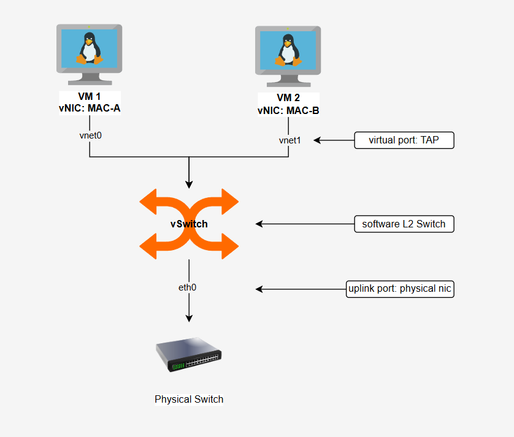
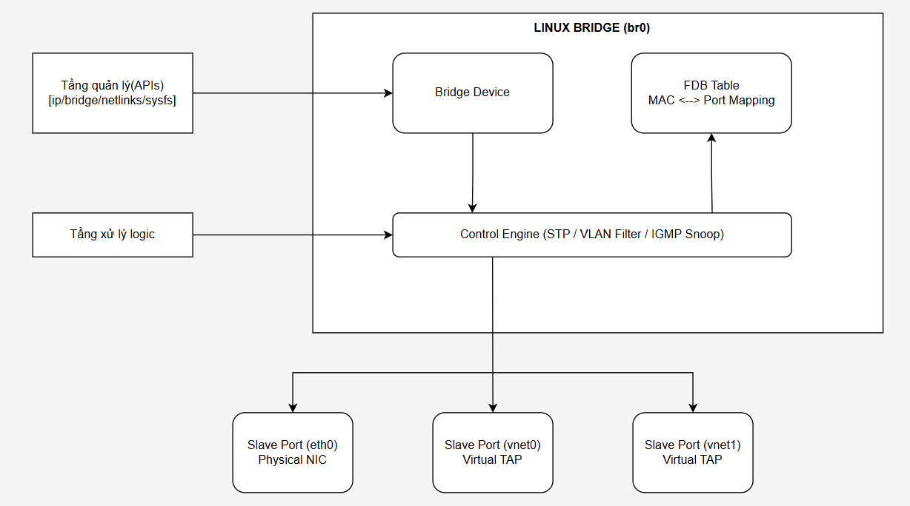

# vSwitch(Virtual Switch) và Linux Bridge
## Virtual Switch
Là 1 Switch ảo. Có công dụng như Switch thực tế nhưng ở trong môi trường ảo hóa.

Là một chương trình phần mềm hoặc một module nằm ở tầng kernel của hệ điều hành ảo hóa. Nhiệm vụ của vSwitch là định tuyến và chuyển tiếp các khung tin (Ethernet Frames) ở Tầng Data Link giữa các VM với nhau, và giữa VM với mạng vật lý bên ngoài.



Các thành phần cấu trúc của Virtual Switch
- Virtual Ports (Cổng ảo): Các cổng kết nối ảo do phần mềm tạo ra. Mỗi card mạng ảo (vNIC) của máy ảo sẽ được cắm vào một Virtual Port.
- TAP/TUN Interface (vnetX): Là thiết bị mạng ảo do hệ điều hành Host tạo ra để làm cầu nối giữa vNIC của QEMU/KVM và vSwitch.
- Uplink Port (Cổng kết nối ngoài): Là card mạng vật lý thật của KVM Host (eth0, enp3s0). Cổng này đóng vai trò như sợi cáp mạng nối từ vSwitch ra Switch vật lý bên ngoài.
- Logical Forwarding Engine: Bộ máy xử lý quy tắc chuyển tiếp khung tin dựa trên địa chỉ MAC.

## Linux Bridge (Layer 2 vSwitch)
Linux Bridge là giải pháp Virtual Switch lâu đời và phổ biến nhất trên hệ điều hành Linux, được tích hợp sẵn trong nhân hệ thống thông qua module `bridge.ko`. Linux Bridge biến KVM Host thành một Switch Layer 2 chuẩn IEEE 802.1D.

Cấu trúc cốt lõi bên trong Linux Bridge
Khi bạn khởi tạo một Linux Bridge (ví dụ: br0), Linux sẽ tạo ra 5 nhóm thành phần quản lý:



### Thân Bridge (Bridge Device Core - struct net_bridge)
Đây là thực thể trung tâm đại diện cho chính Virtual Switch.

Bản chất: Trong Kernel, nó được quản lý bởi cấu trúc struct net_bridge. Nó hoạt động như một giao diện mạng ảo (Virtual Network Interface) trên KVM Host.

Chức năng: 
- Giữ địa chỉ MAC riêng cho chính Bridge (thường lấy theo địa chỉ MAC của cổng thành viên đầu tiên được gắn vào).
- Cho phép gán địa chỉ IP chính trên Host để Host giao tiếp với mạng ảo (Host-to-VM communication).
- Quản lý tập trung thông số của toàn bộ Virtual Switch (như thời gian gia hạn FDB ageing_time, trạng thái bật/tắt STP, trạng thái vlan_filtering).

### Các Cổng Thành Viên (Ports - struct net_bridge_port)
Mọi giao diện mạng (Interface) gắn vào Linux Bridge đều trở thành một cổng (slave port) của Virtual Switch, được quản lý bởi cấu trúc struct net_bridge_port.

Linux Bridge phân loại cổng thành 2 loại chính:
|Cấu trúc Cổng|Giao diện tương ứng|Đặc điểm vận hành trong Kernel|
|-|-|-|
|**Physical Uplink Port**|Card thật (eth0, enp3s0...)|Tự động chuyển sang Promiscuous Mode để nhận mọi gói tin. Bị tước bỏ IP riêng (IP của Host được chuyển sang nằm ở br0).|
|**Virtual Ports (TAP)**|Card ảo (vnet0, vnet1...)|• Cổng nối trực tiếp với vNIC của máy ảo QEMU/KVM.• Tự động sinh ra khi VM khởi động và biến mất khi VM tắt.|

Mỗi net_bridge_port đều mang một chỉ số cổng (port_no), chỉ số ưu tiên (priority), trạng thái STP (state: Disabled, Listening, Learning, Forwarding, Blocking) và cấu hình VLAN PVID.

### Bảng Chuyển Tiếp Địa Chỉ MAC (Forwarding Database - FDB)
FDB là "bộ não" Layer 2 của Linux Bridge, chứa các bản ghi trong cấu trúc `struct net_bridge_fdb_entry`.Cấu trúc một dòng bản ghi (FDB Entry):
- MAC Address: Địa chỉ MAC của thiết bị đầu cuối.
- Port Pointer: Con trỏ trỏ tới cổng net_bridge_port tương ứng đang đấu nối với MAC đó.
- `Flags: is_local`: Địa chỉ MAC thuộc về chính các cổng của Bridge/Host.
  - is_static: Địa chỉ MAC được gán cố định thủ công bởi Sysadmin.
  - is_dynamic: Địa chỉ MAC tự động học được qua các gói tin đi vào.
- Ageing Timer: Đồng hồ đếm lùi (mặc định $300$ giây). Nếu quá thời gian này mà không thấy gói tin chứa MAC nguồn tương ứng gửi vào, bản ghi sẽ bị xóa khỏi FDB.
 
### Các Bộ Máy Điều Kính Logic (Protocol Engines)
Nằm ở tầng xử lý của Kernel, Linux Bridge tích hợp sẵn 3 Sub-system chính:
- Bộ máy STP (Spanning Tree Protocol Engine)
  - Quản lý thuật toán 802.1D STP để phát hiện và ngăn chặn vòng lặp L2 (Loop).
  - Điều khiển chuyển đổi trạng thái của từng net_bridge_port (từ FORWARDING sang BLOCKING nếu phát hiện đường truyền vòng).
- Bộ máy Lọc VLAN (VLAN Filtering Engine)
  - Quản lý qua tham số vlan_filtering=1.
  - Duy trì cấu hình VLAN Group (struct net_bridge_vlan_group) trên từng port để xác định:
    - PVID (Port VLAN ID): VLAN Tag tự động đính vào các Frame chưa có tag đi từ VM/Physical vào port.
    - Egress Untagged/Tagged: Quyết định tháo Tag VLAN hay giữ nguyên Tag VLAN khi gói tin đi ra khỏi port.
- Bộ máy IGMP/MLD Snooping Engine
  - Lắng nghe các gói tin đăng ký nhóm Multicast (IGMP Join/Leave).
  - Giúp Linux Bridge gửi gói Multicast đến chính xác cổng của máy ảo có đăng ký nhận, thay vì flooding tràn lan ra toàn bộ các cổng gây nghẽn mạng.
### Tầng Giao Tiếp Quản Trị (Management & Configuration APIs)
Để người dùng/tiến trình ở User Space (như iproute2, brctl, libvirtd, WebVirtCloud) có thể tác động và thay đổi cấu hình trong Kernel, Linux Bridge cung cấp 3 API giao tiếp:
- Netlink API (rtnetlink): Chuẩn giao tiếp hiện đại và nhanh nhất, được dùng bởi lệnh `ip link`, `bridge fdb`, `bridge vlan`.
- sysfs File System (`/sys/class/net/br0/`): Cung cấp cây thư mục ảo chứa các thông số trạng thái hiện tại của Bridge và Ports dưới dạng file văn bản (cho phép đọc/ghi trực tiếp từ shell).
- ioctl Interface (SIOCGIFBR): Giao diện cũ, được dùng bởi công cụ truyền thống brctl.

## Cơ chế hoạt động & Luồng đi của Dữ liệu (Packet Flow)
Quy trình Học MAC và Chuyển tiếp (MAC Learning & Forwarding)
```Plaintext
          1. Đọc MAC Nguồn (A) + Cổng (vnet0) ──> Lưu vào FDB
[Frame] ──────────────────────────────────────────────────────────► [ Linux Bridge ]
  Src: MAC-A                                                             │
  Dst: MAC-B                                                             │
          2. Tra MAC Đích (B) trong FDB                                 │
             ├── B có trong FDB (thuộc vnet1) ──> Đẩy thẳng ra vnet1 ────┼──> [VM2]
             └── B KHÔNG có trong FDB (Unknown) ──> Flooding toàn bộ ────┴──> [Tất cả các cổng]
```
- Nhận Frame: Một Ethernet Frame từ VM1 đi qua vnet0 vào br0.
- Learning (Học MAC): Bridge đọc Source MAC của Frame. Nếu MAC này chưa có trong bảng FDB, Bridge sẽ ghi lại: "MAC-A nằm ở cổng vnet0".
- Lookup (Tra cứu): Bridge đọc Destination MAC của Frame và tra trong bảng FDB:
  - Nếu thấy Destination MAC = MAC-B (thuộc cổng vnet1): Bridge chuyển thẳng Frame ra cổng vnet1 (Unicast Forwarding).
  - Nếu KHÔNG thấy Destination MAC trong FDB hoặc là Broadcast -> Bridge thực hiện Flooding – nhân bản Frame và gửi ra tất cả các cổng còn lại (vnet1, eth0), ngoại trừ cổng gửi vào (vnet0).

## Các tính năng Layer 2 nâng cao của Linux Bridge
### Chế độ Nhận diện mở rộng (Promiscuous Mode)
Card mạng vật lý thông thường chỉ chấp nhận gói tin có MAC trùng với MAC của chính nó.

Khi gộp `eth0` vào `br0`, `eth0` bắt buộc phải bật Promiscuous Mode. Nhờ đó, card thật `eth0` mới có thể nhận hộ các Ethernet Frame chứa địa chỉ MAC đích của các máy ảo (VM1, VM2...) từ Switch bên ngoài truyền vào.

### Phân chia VLAN (802.1Q VLAN Filtering)
Linux Bridge hỗ trợ 2 cách triển khai VLAN L2:
- Traditional VLAN Bridge (Nhiều Bridge): Tạo các giao diện VLAN ảo trên card thật (ví dụ `eth0.10`, `eth0.20`), sau đó gắn từng interface này vào các Bridge riêng biệt (`br-vlan10`, `br-vlan20`).
- VLAN-Aware Bridge (1 Bridge duy nhất): Bật tính năng vlan_filtering=1 trên br0. Phương pháp này cho phép xử lý Tagging/Untagging (Access/Trunk port) trực tiếp trên từng cổng vnetX của một Linux Bridge duy nhất, tương tự như Cấu hình Switch Cisco/HP.

### Ngăn ngừa Vòng lặp Mạng với STP (Spanning Tree Protocol)
Khi KVM Host có nhiều card mạng vật lý (eth0, eth1) cùng cắm vào một Linux Bridge và nối lên Switch thật để dự phòng link (Redundancy), rủi ro lặp vòng L2 (Switching Loop) sẽ xảy ra.

Linux Bridge tích hợp sẵn chuẩn STP (802.1D). Khi bật STP (brctl stp br0 on), Bridge sẽ tự động khóa (Block) cổng dự phòng để chống nghẽn mạng do Bão Broadcast (Broadcast Storm).

### Rủi ro Bảo mật & Cơ chế Lọc Layer 2 (MAC Spoofing)
Rủi ro mặc định: Linux Bridge thuần túy chỉ làm nhiệm vụ chuyển tiếp L2, không có cơ chế chặn máy ảo tự đổi MAC (MAC Spoofing) hoặc tự đóng giả làm DHCP Server (DHCP Spoofing).

Giải pháp: Để bảo mật L2 trên Linux Bridge, quản trị viên sử dụng ebtables (Ethernet Bridge Tables) hoặc nftables ở tầng Kernel để tạo bộ lọc:
- Chỉ cho phép cổng vnet0 gửi gói tin chứa đúng địa chỉ MAC/IP đã được cấp phát.
- Chặn các gói tin DHCP Offer xuất phát từ các cổng vnetX của máy ảo.