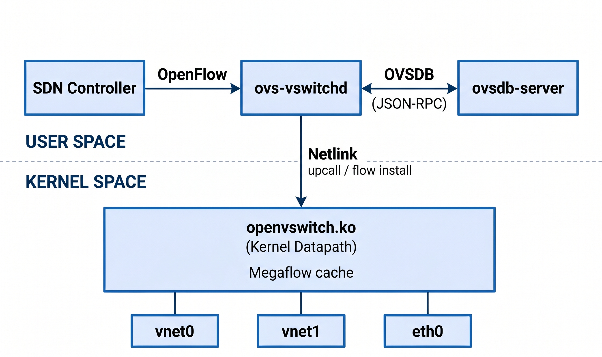
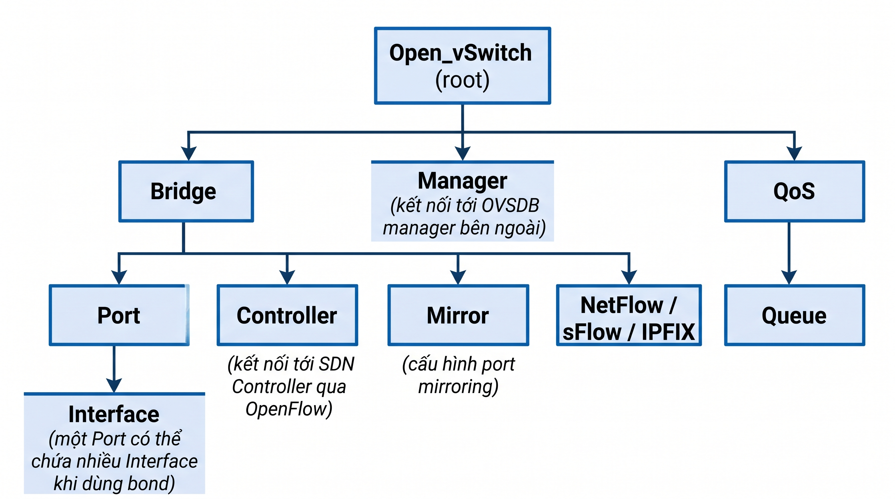
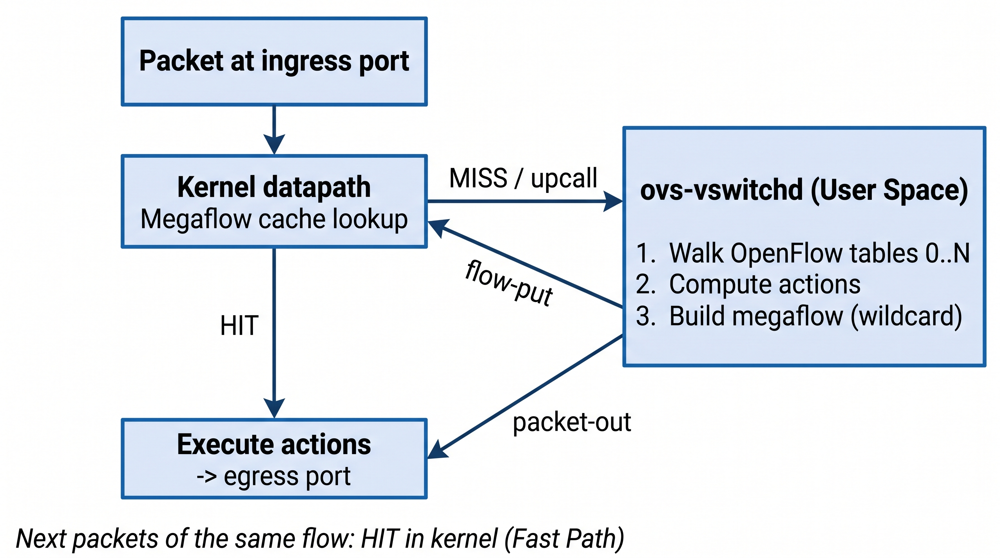

# Open vSwitch (OVS)

## 1. Khái niệm

**Open vSwitch (OVS)** là một Virtual Switch đa tầng (Multilayer Virtual Switch) mã nguồn mở, được thiết kế cho môi trường ảo hóa, Data Center quy mô lớn và hệ thống Mạng định nghĩa bằng phần mềm (SDN – Software-Defined Networking). Thành phần User Space phát hành theo giấy phép Apache 2.0, module Kernel theo GPLv2. Dự án khởi nguồn từ Nicira và hiện thuộc Linux Foundation.

OVS thực hiện chuyển mạch ở **Layer 2** và có khả năng **match/biến đổi header từ Layer 2 đến Layer 4** (MAC, VLAN, IP, TCP/UDP port, Tunnel ID, trạng thái connection tracking). OVS **không phải router**: không có bảng định tuyến (FIB) hay giao thức routing; các tác vụ L3 chỉ ở mức sửa đổi header theo flow, còn định tuyến logic do lớp phía trên (ví dụ OVN) đảm nhiệm.

OVS được điều khiển qua hai giao thức chuẩn có vai trò khác nhau:

| Giao thức | Vai trò | Đối tượng tác động |
|---|---|---|
| **OpenFlow** | Nạp và quản lý các **flow rule** (hành vi chuyển tiếp) | Data plane – bảng flow trong `ovs-vswitchd` |
| **OVSDB** (RFC 7047, JSON-RPC) | Quản lý **cấu hình** (bridge, port, interface, tunnel, QoS, mirror…) | Cơ sở dữ liệu cấu hình trong `ovsdb-server` |

## 2. Đặc điểm nổi bật

- **Kiến trúc phân tách (Decoupled Architecture):** Tách phần xử lý quyết định và quản lý (`ovs-vswitchd`, `ovsdb-server` ở User Space) khỏi phần chuyển tiếp tốc độ cao (Datapath ở Kernel Space). Lưu ý: Control Plane theo nghĩa SDN là **SDN Controller bên ngoài**; `ovs-vswitchd` là tiến trình triển khai OpenFlow switch và xử lý Slow Path.
- **Khả năng lập trình (Programmability):** Hỗ trợ OpenFlow 1.0–1.5 (mức hỗ trợ khác nhau tùy phiên bản) cùng các extension riêng (Nicira Extensible Match, `conntrack`, `learn`, `resubmit`…), cho phép controller (OpenDaylight, ONOS, Ryu, OVN…) lập trình hành vi mạng.
- **Hiệu năng cao nhờ caching:** Kernel Datapath sử dụng **Megaflow cache** để chuyển tiếp các gói tin sau gói đầu tiên mà không cần lên User Space. Có thể tăng tốc thêm bằng **OVS-DPDK** (userspace datapath) hoặc **Hardware Offload** (TC Flower/switchdev, rte_flow).
- **Tích hợp sâu trong hệ sinh thái Cloud:** OpenStack Neutron (ML2/OVS, ML2/OVN), Kubernetes (Antrea, OVN-Kubernetes), XenServer/XCP-ng (OVS là network backend mặc định), Proxmox VE (hỗ trợ tùy chọn, mặc định là Linux Bridge), KVM/libvirt.
- **Khả năng quan sát (Observability) sẵn có:** NetFlow, sFlow, IPFIX, port mirroring, thống kê theo từng flow/port.

## 3. Các tính năng cốt lõi và nâng cao

| Nhóm tính năng | Tên tính năng | Mô tả kỹ thuật |
|---|---|---|
| **Layer 2** | VLAN 802.1Q & QinQ (802.1ad) | Cổng Access, Trunk, native VLAN; Tag/Untag; chồng hai VLAN tag. |
| | MAC learning (action `NORMAL`) | Hoạt động như L2 learning switch truyền thống khi không có flow tùy biến. |
| | STP / RSTP | Chống loop L2 giữa các bridge. |
| **Xử lý theo Flow** | Flow-based Forwarding | Match trên tổ hợp trường bất kỳ (in_port, MAC, VLAN, IP, TCP/UDP port, Tunnel ID, `ct_state`…) rồi thực thi chuỗi **Action**: `output`, `set_field`, `push/pop VLAN`, `ct` (conntrack/NAT), `resubmit`, `group`, `meter`, `learn`… |
| **Mạng đè (Overlay)** | VXLAN, GENEVE, GRE | Đóng gói L2 qua hạ tầng L3, cho phép VM ở các host khác nhau chung một broadcast domain logic. GENEVE là giao thức overlay mặc định của OVN. |
| | STT | Đã lỗi thời (deprecated), không khuyến nghị; khả năng hỗ trợ tùy phiên bản OVS. |
| **Bảo mật** | Stateful Firewall (`conntrack`) | Tích hợp connection tracking (kernel conntrack hoặc userspace conntrack trong OVS-DPDK) để xây dựng rule L3/L4 có trạng thái, NAT. |
| | Port Security / Anti-Spoofing | **Không phải tính năng built-in của OVS.** Được hiện thực bằng **OpenFlow rule** do controller/CMS nạp (ví dụ Neutron Port Security, OVN ACL) để chặn giả mạo MAC/IP/ARP và DHCP trái phép. |
| **Giám sát** | NetFlow, sFlow, IPFIX | Xuất thống kê luồng về collector tập trung. |
| | SPAN / RSPAN / ERSPAN | **SPAN:** mirror sang cổng cục bộ. **RSPAN:** mirror sang một VLAN chuyên dụng (L2). **ERSPAN:** đóng gói GRE để mirror qua mạng L3. |
| **QoS** | Ingress Policing, Egress Shaping, Meter | Giới hạn tốc độ nhận vào; shaping và quản lý hàng đợi chiều ra (thông qua Linux tc, ví dụ HTB); OpenFlow Meter. |
| **Độ sẵn sàng** | Bonding / LACP (802.3ad) | Gộp nhiều NIC vật lý để tăng băng thông và failover (xem mục 7). |
| | BFD, CFM (802.1ag) | Phát hiện sự cố đường truyền nhanh, hỗ trợ chuyển đổi dự phòng. |

## 4. Kiến trúc thành phần

Kiến trúc phần mềm OVS gồm hai khu vực thực thi chính (User Space và Kernel Space), trong đó Datapath có thể được thay thế bằng userspace datapath (DPDK) hoặc offload xuống phần cứng.



*Chú thích:* `vnetX` là TAP interface của máy ảo (do libvirt/hypervisor tạo); `ethX` là NIC vật lý. SDN Controller kết nối tới `ovs-vswitchd` qua OpenFlow (nạp flow) và có thể kết nối tới `ovsdb-server` qua OVSDB với vai trò *manager* (cấu hình bridge/port).

### A. Tầng User Space

**`ovs-vswitchd` (Switch Daemon)**

- Tiến trình trung tâm triển khai logic của switch; đọc cấu hình từ `ovsdb-server` và áp dụng xuống Datapath.
- Quản lý OpenFlow pipeline (các bảng flow Table 0…N) và giao tiếp OpenFlow với SDN Controller.
- Xử lý **Slow Path**: nhận gói tin miss từ Kernel (upcall), tra cứu OpenFlow pipeline, tính Action rồi nạp lại flow xuống Kernel Datapath.
- Vận hành các luồng xử lý: **handler threads** (xử lý upcall) và **revalidator threads** (kiểm tra tính hợp lệ, thống kê và xóa flow hết hạn khỏi Datapath).

**`ovsdb-server` (Database Server)**

- Lưu trữ cấu hình dạng JSON (mặc định `conf.db`), gồm: Bridge, Port, Interface, Tunnel, QoS, Mirror, Controller…
- Cung cấp giao thức OVSDB (JSON-RPC) để các ứng dụng và công cụ truy vấn, thay đổi và theo dõi (monitor) cấu hình.

**Các công cụ điều khiển**

| Công cụ | Vai trò |
|---|---|
| `ovs-vsctl` | Cấu hình `ovsdb-server`: bridge, port, VLAN, tunnel, bond, mirror… |
| `ovs-ofctl` | Quản lý và quan sát OpenFlow flow của bridge. |
| `ovs-appctl` | Gửi lệnh điều khiển trực tiếp tới các daemon đang chạy để kiểm tra trạng thái nội bộ, debug, mô phỏng đường đi gói tin. |
| `ovs-dpctl` | Quan sát trực tiếp flow trong Kernel Datapath. |

### B. Tầng Kernel Space (Fast Path)

- **Module `openvswitch.ko`:** nhận Ethernet frame từ TAP interface của VM hoặc NIC vật lý, thực hiện tra cứu flow và thực thi Action ngay trong Kernel.
- **Kernel flow table (Megaflow cache):** lưu các flow đã được `ovs-vswitchd` nạp. Mỗi mục là một *megaflow* — flow có **wildcard mask**, chỉ chứa các trường mà pipeline thực sự đã tham chiếu khi xử lý, nhờ đó một mục có thể khớp nhiều luồng khác nhau.
- Khi gói tin khớp: thực thi Action và chuyển tiếp, không cần context switch lên User Space.

> **Lưu ý:** *Exact Match Cache (EMC)* và *Signature Match Cache (SMC)* là cơ chế cache của **userspace datapath** (OVS-DPDK), không phải của kernel datapath.

### C. Userspace Datapath (OVS-DPDK)

- Thay Kernel Datapath bằng datapath chạy hoàn toàn ở User Space (kiểu `netdev`) dựa trên **DPDK**.
- Sử dụng **Poll Mode Driver (PMD) threads** truy cập trực tiếp NIC (bypass network stack của Kernel), kết hợp **hugepages**; kết nối VM qua **vhost-user**.
- Hệ thống lookup nhiều tầng trong userspace: **EMC → SMC → dpcls** (classifier megaflow theo tuple space search).
- Đánh đổi: đạt throughput gói/giây cao hơn nhưng tiêu tốn core CPU dành riêng (PMD luôn polling) và độ phức tạp cấu hình cao hơn.

### D. Hardware Offload

- Đẩy flow đã được xử lý xuống NIC/SmartNIC/DPU thông qua **TC Flower** (kernel datapath, kết hợp **switchdev mode** và **VF representor**) hoặc **rte_flow** (DPDK).
- Gói tin thuộc flow đã offload được chuyển tiếp hoàn toàn bằng phần cứng; các gói miss vẫn đi qua Slow Path của OVS.
- Phân biệt với **SR-IOV thuần**: VF passthrough cấp thẳng NIC ảo cho VM và **bypass hoàn toàn OVS**; offload mới là cách giữ nguyên khả năng điều khiển của OVS đồng thời tăng tốc bằng phần cứng.

### So sánh ba mô hình Datapath

| Tiêu chí | Kernel Datapath | OVS-DPDK | Hardware Offload |
|---|---|---|---|
| Nơi xử lý gói | Kernel | User Space (PMD) | NIC / SmartNIC / DPU |
| Cơ chế cache | Megaflow cache | EMC → SMC → dpcls | Flow table phần cứng |
| Tài nguyên CPU | Dùng chung, theo tải | Core dành riêng (polling) | Giải phóng CPU host |
| Yêu cầu | Chỉ cần kernel hỗ trợ | DPDK-compatible NIC, hugepages | NIC/DPU hỗ trợ offload |

## 5. Mô hình dữ liệu cấu hình OVSDB

Cấu hình của OVS được tổ chức theo cấu trúc phân cấp trong `ovsdb-server`:



| Bảng | Ý nghĩa |
|---|---|
| **Open_vSwitch** | Bản ghi gốc; chứa danh sách Bridge và các thông số toàn cục. |
| **Bridge** | Một switch ảo; thuộc tính như `fail_mode`, `datapath_type`, protocol OpenFlow được phép. |
| **Port** | Điểm gắn vào bridge; có cấu hình VLAN (`tag`/`trunks`), bond, LACP. |
| **Interface** | Giao diện thực tế: `system` (NIC vật lý), `internal`, `tap`, `patch` (nối hai bridge), tunnel (`vxlan`, `geneve`, `gre`), `dpdk`, `dpdkvhostuser`. |
| **Controller / Manager** | Địa chỉ SDN Controller (OpenFlow) và OVSDB manager. |

## 6. Cơ chế hoạt động và luồng xử lý gói tin

OVS kết hợp **Fast Path (Kernel)** và **Slow Path (User Space)** để cân bằng giữa hiệu năng và tính linh hoạt.



### Các bước xử lý

1. **Ingress:** Gói tin từ VM đi vào cổng (ví dụ `vnet0`).
2. **Tra cứu Megaflow cache (Fast Path):** `openvswitch.ko` đối chiếu gói tin với Kernel flow table.
3. **Cache HIT:** Thực thi Action (đổi VLAN, đóng gói tunnel, đẩy ra `eth0`…) và chuyển tiếp ngay.
4. **Cache MISS → Upcall:** Datapath gửi gói tin lên `ovs-vswitchd` qua **Netlink upcall**; một handler thread tiếp nhận.
5. **Tra cứu OpenFlow pipeline:** `ovs-vswitchd` đối chiếu gói tin qua các bảng OpenFlow (Table 0 → Table N), theo thứ tự ưu tiên và các action `resubmit`/`goto_table`, để xác định tập Action.
6. **Sinh megaflow và nạp cache:** Kết quả được gửi xuống Kernel gồm (a) **packet-out** để xử lý gói tin hiện tại và (b) **flow-put** để cài một megaflow mới. Megaflow chỉ giữ các trường đã được pipeline sử dụng (các trường còn lại để wildcard).
7. **Các gói tiếp theo:** Khớp megaflow ngay trong Kernel (Cache HIT) và được chuyển tiếp ở tốc độ tối đa.

### Quản lý vòng đời flow

- **Revalidator threads** định kỳ rà soát megaflow trong Datapath: xác nhận còn đúng với OpenFlow pipeline hiện tại (khi rule thay đổi), thu thập thống kê.
- Megaflow **không có lưu lượng** sau một khoảng *idle timeout* (mặc định khoảng 10 giây) sẽ bị xóa khỏi cache; gói tin kế tiếp của luồng đó sẽ phải upcall lại.
- Hệ quả: **gói đầu tiên của mỗi megaflow có độ trễ cao hơn**; tải có tỷ lệ tạo kết nối mới rất lớn sẽ gây áp lực lên `ovs-vswitchd`.

### Hành vi mặc định và chế độ lỗi

- **Action `NORMAL`:** khi bridge chưa có flow tùy biến, OVS xử lý như một L2 learning switch (học MAC, flood khi chưa biết đích, áp dụng VLAN/bond).
- **`fail-mode`** (khi mất kết nối tới controller):
  - `standalone`: OVS tự chuyển sang hoạt động như learning switch thông thường.
  - `secure`: OVS không tự thêm flow; các flow đã có tiếp tục hoạt động, luồng mới bị chặn cho tới khi controller hồi phục.

## 7. Bonding và LACP

| Chế độ bond | Đặc điểm |
|---|---|
| `active-backup` | Một link hoạt động, các link còn lại dự phòng; không cần cấu hình phía switch vật lý. |
| `balance-slb` | Cân bằng tải theo Source MAC + VLAN; không cần LACP phía switch vật lý. |
| `balance-tcp` | Cân bằng tải theo hash L2–L4; **yêu cầu LACP**; phân phối đồng đều hơn nhưng tốn tài nguyên tra cứu hơn. |

**LACP (802.3ad)** có thể bật ở chế độ *active* hoặc *passive* để thương lượng bonding động với switch vật lý. Phát hiện lỗi link có thể bổ trợ bằng BFD hoặc CFM.

## 8. OVN (Open Virtual Network)

**OVN** là dự án xây dựng trên nền OVS, cung cấp lớp **mạng ảo logic** (logical switch, logical router, ACL, NAT, load balancer, DHCP native) thay vì để người dùng tự viết OpenFlow thủ công.

```text
CMS (OpenStack Neutron / Kubernetes)
        |   cấu hình mạng logic
        v
OVN Northbound DB
        |
        v
    ovn-northd            dịch cấu hình logic -> logical flows
        |
        v
OVN Southbound DB
        |   (mỗi hypervisor kết nối tới)
        v
   ovn-controller         dịch logical flows -> OpenFlow cục bộ
        |
        v
   OVS (ovs-vswitchd + ovsdb-server) trên từng host
```

- Overlay mặc định: **GENEVE** (mang metadata logic trong header tunnel).
- Định tuyến L3, NAT, ACL, DHCP được thực hiện **phân tán** ngay trên các hypervisor.
- OVN đóng vai trò SDN Controller chuẩn cho OVS trong OpenStack và Kubernetes hiện nay.

## 9. So sánh mô hình: Open vSwitch và Linux Bridge

| Tiêu chí | Linux Bridge | Open vSwitch |
|---|---|---|
| **Cơ chế chuyển tiếp** | MAC-based: tra bảng FDB theo Destination MAC (học theo Source MAC). | Flow-based: match đa trường L2–L4, metadata, tunnel ID, trạng thái conntrack. |
| **Biến đổi gói tin** | Mặc định chỉ chuyển tiếp frame; có thể mở rộng bằng `br_netfilter`/ebtables/nftables. | Sửa MAC/IP, push/pop VLAN, NAT, đóng gói tunnel ngay trong pipeline. |
| **VLAN** | Hỗ trợ VLAN filtering (802.1Q). | Hỗ trợ 802.1Q, QinQ, VLAN theo flow. |
| **Overlay tunnel** | VXLAN/GRE tạo qua interface riêng; quản lý rời rạc. | VXLAN/GENEVE/GRE tích hợp trong pipeline, điều khiển tập trung theo flow. |
| **Điều khiển** | Cố định theo chuẩn L2 switch (802.1D), cấu hình tĩnh. | Lập trình được qua OpenFlow/OVSDB, phù hợp tự động hóa và SDN. |
| **Giám sát** | Cơ bản (thống kê interface, công cụ ngoài). | NetFlow/sFlow/IPFIX, mirroring, thống kê theo flow. |
| **Hiệu năng** | Overhead thấp với L2 forwarding đơn giản. | Tối ưu bằng megaflow cache, DPDK, offload; overhead phụ thuộc workload (đặc biệt tỷ lệ flow mới). |
| **Độ phức tạp vận hành** | Thấp; thành phần có sẵn trong kernel. | Cao hơn: nhiều daemon, nhiều cơ chế cache, debug theo flow. |
| **Phù hợp** | Mạng đơn giản, ít yêu cầu tính năng. | Cloud, multi-tenant, SDN, cần overlay và chính sách mạng chi tiết. |

## 10. Mô hình triển khai và ứng dụng thực tế

### 10.1. OpenStack Neutron

| Thành phần | ML2/OVS | ML2/OVN |
|---|---|---|
| Bridge | `br-int` (tích hợp VM), `br-tun` (tunnel), `br-ex`/bridge provider (ra mạng ngoài) | `br-int` và bridge provider; **không có `br-tun`** |
| Overlay | VXLAN/GRE giữa các host qua `br-tun` | GENEVE |
| Security Group | OVS native firewall driver (conntrack) hoặc hybrid (Linux Bridge + iptables) | OVN ACL (conntrack) |
| L3/DHCP | L3 agent, DHCP agent riêng | OVN native (router, DHCP phân tán) |
| Điều khiển | `neutron-openvswitch-agent` | `ovn-controller` + OVN DB |

ML2/OVN đang dần thay thế ML2/OVS làm lựa chọn mặc định ở các bản OpenStack gần đây; cần xác định rõ driver và phiên bản khi mô tả kiến trúc.

### 10.2. Kubernetes Networking

- **Antrea:** CNI sử dụng **OVS trực tiếp** làm data plane trên mỗi node; triển khai NetworkPolicy bằng flow/conntrack của OVS và có thể thay thế kube-proxy cho Service (AntreaProxy).
- **OVN-Kubernetes:** CNI sử dụng **OVN** (và OVS bên dưới): logical switch/router cho pod network, overlay GENEVE, NetworkPolicy qua OVN ACL, load balancer qua OVN. Là CNI mặc định của Red Hat OpenShift.

### 10.3. SDN Data Center đa khách hàng (Multi-tenant)

- OVS trên các host ảo hóa (KVM/Xen) kết nối với controller tập trung (OpenDaylight, ONOS hoặc OVN).
- Mỗi tenant được cô lập bằng overlay (VNI/Tunnel ID) và chính sách flow/ACL riêng; việc khởi tạo, thay đổi mạng được tự động hóa.
- Xu hướng hiện nay nghiêng về OVN do tích hợp sẵn các dịch vụ mạng logic và phân tán.

## 11. Ưu điểm và hạn chế

**Ưu điểm**

- Tính năng phong phú (overlay, conntrack, QoS, mirroring, telemetry) trong một thành phần mã nguồn mở.
- Lập trình và tự động hóa linh hoạt qua OpenFlow/OVSDB; nền tảng cho OVN và nhiều CNI.
- Nhiều lựa chọn tối ưu hiệu năng: megaflow cache, DPDK, hardware offload.
- Được hỗ trợ rộng rãi trong hệ sinh thái Cloud/ảo hóa.

**Hạn chế**

- Độ phức tạp vận hành và debug cao (nhiều lớp cache, pipeline OpenFlow, daemon).
- Gói đầu tiên của mỗi megaflow phải qua Slow Path; tải có tỷ lệ tạo kết nối mới cao có thể gây nghẽn `ovs-vswitchd`.
- OVS-DPDK tiêu tốn core CPU dành riêng và đòi hỏi cấu hình hạ tầng phù hợp.
- Các tính năng nâng cao (bảo mật theo VM, routing logic) cần controller/CMS phía trên hiện thực, không có sẵn trong bản thân OVS.

## 12. Kết luận

Open vSwitch là virtual switch đa tầng, chuyển tiếp theo **flow** với kiến trúc hai tầng: **Slow Path** (`ovs-vswitchd`, OpenFlow pipeline) quyết định, **Fast Path** (Kernel Megaflow cache) chuyển tiếp tốc độ cao. Giá trị cốt lõi của OVS nằm ở khả năng lập trình luồng dữ liệu, hỗ trợ overlay và tích hợp với nền tảng Cloud/SDN, đặc biệt qua OVN. Khi áp dụng cần phân biệt rõ: tính năng nào do OVS cung cấp, tính năng nào do controller/CMS hiện thực qua flow rule; datapath nào đang dùng (Kernel, DPDK, Offload); và driver/phiên bản của nền tảng triển khai (ML2/OVS hay ML2/OVN).

## 13. Tài liệu tham khảo

- Open vSwitch Documentation — <https://docs.openvswitch.org>
- RFC 7047 — The Open vSwitch Database Management Protocol — <https://www.rfc-editor.org/rfc/rfc7047>
- OpenFlow Switch Specification — Open Networking Foundation — <https://opennetworking.org>
- OVN Documentation — <https://docs.ovn.org>
- Antrea Documentation — <https://antrea.io/docs>
- OpenStack Neutron Documentation — <https://docs.openstack.org/neutron>