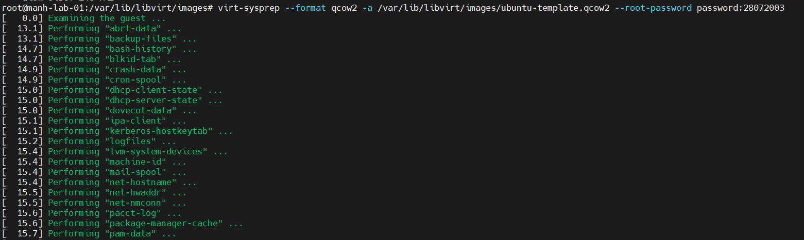
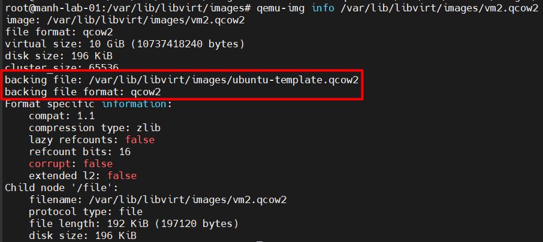

# Lab tạo Templates và tạo VM từ Templates
## Mục tiêu
Bài lab này thực hiện chuyển đổi đĩa đệm của vm1 trên NFS Shared Storage thành Golden Template, sau đó nhân bản 2 máy ảo mới:
- Host 1 tạo `vm2` (Linked Clone) tức thì bằng cách tạo đĩa mỏng trỏ về NFS Template.
- Host 2 có thể đọc trực tiếp NFS Template để tạo `vm3` (Full Clone) ngay tại Host 2 mà không cần truyền đĩa thủ công qua SSH giữa 2 Host.

## Chuẩn hóa `vm1` thành Golden Template trên NFS
Tắt `vm1` có thể dùng `shutdown` hoặc `destroy`
```bash
virsh destroy vm1
```
Cài đặt `guestfs-tools`
```Bash
apt update && apt install -y guestfs-tools
```
Dọn dẹp định danh và cài sẵn Root Password:
```Bash
virt-sysprep --format qcow2 -a /var/lib/libvirt/images/ubuntu-template.qcow2 --root-password password:28072003
```



Khóa quyền ghi để bảo về Template
```Bash
chmod 444 /var/lib/libvirt/images/ubuntu-template.qcow2
```
## Triển khai VM2 trên Host 1 (Linked Clone)
Tạo đĩa đệm mỏng 10GB trỏ liên kết về NFS Template:
```Bash
qemu-img create -f qcow2 -b /var/lib/libvirt/images/ubuntu-template.qcow2 -F qcow2 /var/lib/libvirt/images/vm2.qcow2 10G
chown libvirt-qemu:kvm /var/lib/libvirt/images/vm2.qcow2
```
Dấu hiệu nhận biết: 
- Tham số `-b /var/lib/libvirt/images/ubuntu-template.qcow2` (Backing File).
- Bản chất: Lệnh này tạo ra một ổ đĩa ảo mỏng (`vm2.qcow2`). Ổ đĩa này chỉ lưu phần dữ liệu thay đổi phát sinh trong quá trình chạy, còn toàn bộ dữ liệu hệ điều hành gốc vẫn đọc trực tiếp từ file `ubuntu-template.qcow2`.

Kiểm tra lại:



Ở đây chúng ta có thể bỏ qua bước cài đặt với tùy chọn `--import` do tham số `--import` trong câu lệnh virt-install dùng để bỏ qua toàn bộ quá trình cài đặt hệ điều hành thủ công (từ file ISO) và khởi động thẳng vào ổ đĩa ảo đã chứa sẵn OS và ở đây tôi dùng file cloud image của Ubuntu

Khởi tạo máy ảo vm2:
```Bash
virt-install \
  --name vm2 \
  --ram 1024 \
  --vcpus 1 \
  --os-variant ubuntu24.04 \
  --disk path=/var/lib/libvirt/images/vm2.qcow2,format=qcow2,bus=virtio \
  --network network=lab-net,model=virtio \
  --graphics vnc,listen=0.0.0.0 \
  --import \
  --noautoconsole
```
Kiểm tra lại:
```Bash
root@manh-lab-01:/var/lib/libvirt/images# virsh list --all
 Id   Name   State
-----------------------
 1    vm2    running
 -    vm1    shut off

```
## Triển khai VM3 trên Host 2 (Full Clone)
Copy toàn bộ đĩa đệm từ NFS Template thành đĩa độc lập và thực hiện phân quyền
```Bash
# Copy
cp /var/lib/libvirt/images/ubuntu-template.qcow2 /var/lib/libvirt/images/vm3.qcow2

# Phân quyền
chown libvirt-qemu:kvm /var/lib/libvirt/images/vm3.qcow2
chmod 660 /var/lib/libvirt/images/vm3.qcow2
```
Dấu hiệu nhận biết: Sử dụng lệnh copy tiêu chuẩn cp.

Bản chất: Lệnh này sao chép 100% khối dữ liệu từ file gốc sang file `vm3.qcow2`. File mới này hoàn toàn độc lập, không còn bất kỳ liên kết hay phụ thuộc nào vào file đĩa mẫu `ubuntu-template.qcow2`.

Khởi tạo máy ảo vm3:
```
virt-install \
  --name vm3 \
  --ram 1024 \
  --vcpus 1 \
  --os-variant ubuntu24.04 \
  --disk path=/var/lib/libvirt/images/vm3.qcow2,format=qcow2,bus=virtio \
  --network network=lab-net,model=virtio \
  --graphics vnc,listen=0.0.0.0 \
  --import \
  --noautoconsole
```
Kiểm tra lại
```
root@manh-lab-02:~# virsh list --all
 Id   Name   State
----------------------
 1    vm3    running
```
## Trường hợp muốn Full-Clone trên cùng 1 Host
Ít khi sử dụng. Trường hợp này sẽ sao chép 1 máy ảo.

Ví dụ như sau:
```
root@manh-lab-01:/var/lib/libvirt/images# virt-clone \
  --original vm1 \
  --name vm4 \
  --file /var/lib/libvirt/images/vm4.qcow2
Allocating 'vm4.qcow2'                                                                                                                  |    0 B  00:00:00 ...

Clone 'vm4' created successfully.
root@manh-lab-01:/var/lib/libvirt/images# virsh list --all
 Id   Name   State
-----------------------
 1    vm2    running
 -    vm1    shut off
 -    vm4    shut off

```
Hoặc thâm chí bạn cũng có thể clone `vm2`(1 bản linked clone từ cloud image ở nfs server)