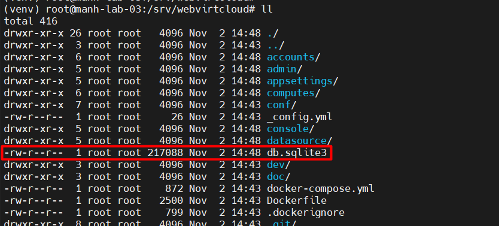
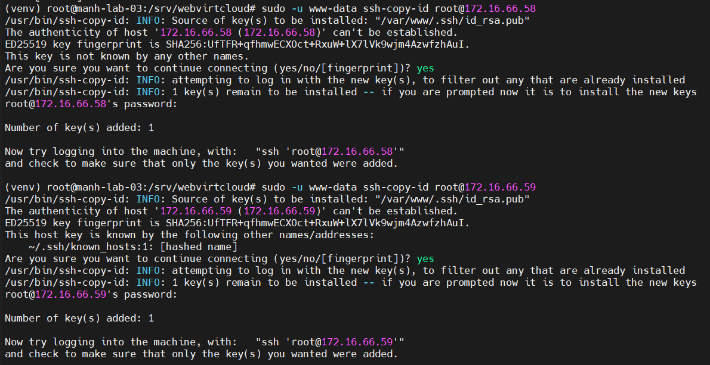
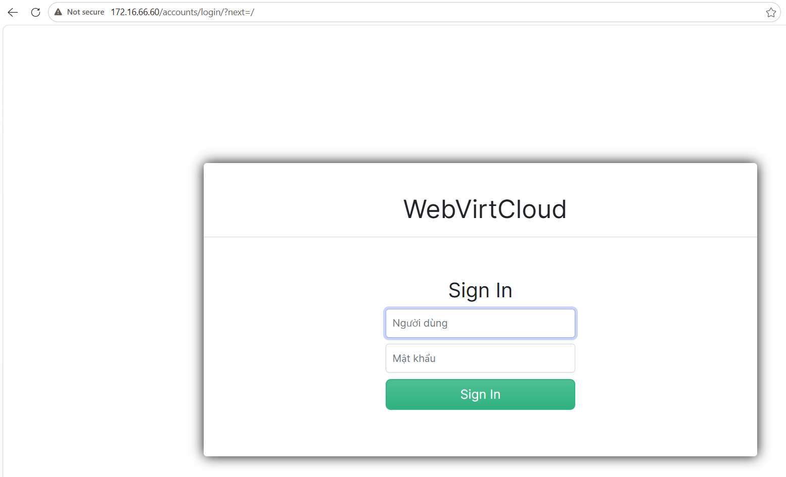
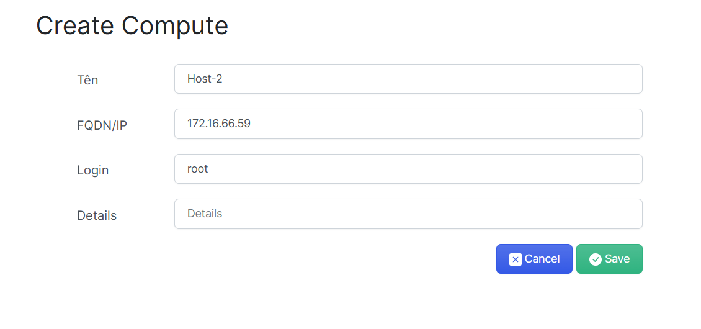
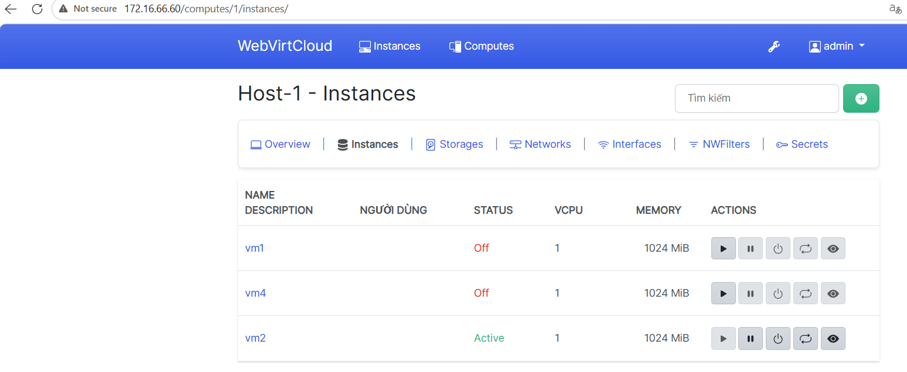
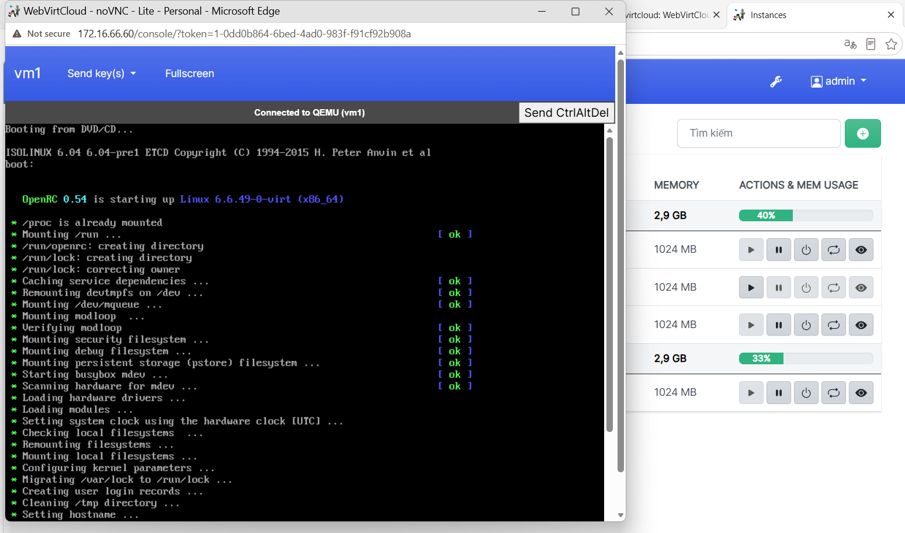

# Triển khai và sử dụng WebVirtCloud
## Mục tiêu
Cài đặt thủ công và sử dụng WebVirtCloud để thực quản lý các VM trong hệ thống KVM

Để hiểu sâu và nắm được bản chất cách vận hành, bài lab này sẽ thực hiện cài đặt và cấu hình thủ công
## Mô hình
3 thiết bị
- `.58` Host 1
- `.59` Host 2
- `.60` Server
# Phân tải hệ thống
|Thành phần|Tài nguyên tiêu tốn chính|Nhiệm vụ chính|
|-|-|-|
|Compute Nodes (.58 & .59)|CPU & RAM vật lý|Chạy các vCPU, phân phối RAM ảo và thực thi lệnh ảo hóa cứng (KVM/QEMU).|
|Management & Storage Node (.60)|I/O Ổ đĩa & Băng thông Mạng|Xử lý giao diện Web, làm NFS Storage đọc/ghi đĩa ảo và làm Proxy trung chuyển dữ liệu Console.|

## Cài đặt và cấu hình WebVirtCloud
Cài đặt các gói update và các gói hỗ trợ
```Bash
apt update 
apt install -y git python3-venv python3-dev pkg-config libvirt-dev libxml2-dev libxslt1-dev gcc make supervisor nginx
```
Tải mã nguồn và thiết lập môi trường ảo
```Bash
# Clone thư mục từ github
git clone https://github.com/retspen/webvirtcloud.git /srv/webvirtcloud
cd /srv/webvirtcloud

# Tạo và khởi chạy môi trường ảo
python3 -m venv --system-site-packages venv
source venv/bin/activate

# Nâng cấp và cài đặt các gói cần thiết
pip install --upgrade pip
pip install -r conf/requirements.txt
pip install gunicorn
```

Cấu hình Django và khởi tạo Database
```
# Khởi tạo file settings
cp webvirtcloud/settings.py.template webvirtcloud/settings.py

# Sinh khóa SECRET_KEY tự động cho Django
SECRET_KEY=$(python3 -c 'import secrets; print(secrets.token_urlsafe(50))')
# Ghi đè khóa
sed -i "s|^SECRET_KEY = .*|SECRET_KEY = \"${SECRET_KEY}\"|" webvirtcloud/settings.py

# Nạp cơ sở dữ liệu và gom file giao diện
python3 manage.py migrate
python3 manage.py collectstatic --noinput
```
Kiểm tra xuất hiện file `db.sqlite3`



Cấu hình Supervisor điều khiển tiến trình ngầm: Tạo file cấu hình `/etc/supervisor/conf.d/webvirtcloud.conf`:
```TOML
[program:webvirtcloud]
command=/srv/webvirtcloud/venv/bin/gunicorn --bind 127.0.0.1:8000 webvirtcloud.wsgi:application
directory=/srv/webvirtcloud
user=www-data
autostart=true
autorestart=true
redirect_stderr=true
stdout_logfile=/var/log/supervisor/webvirtcloud.log

[program:novnc]
command=/srv/webvirtcloud/venv/bin/python /srv/webvirtcloud/console/novncd
directory=/srv/webvirtcloud
user=www-data
autostart=true
autorestart=true
redirect_stderr=true
stdout_logfile=/var/log/supervisor/novnc.log
```
- Đây là file cấu hình Supervisor, dùng để quản lý và duy trì hoạt động của hai tiến trình trong WebVirtCloud. Trong đó:
  - `webvirtcloud` sử dụng Gunicorn để chạy ứng dụng Django, cung cấp giao diện quản lý máy ảo KVM.
  - `novnc` sử dụng Python để chạy dịch vụ noVNC, hỗ trợ truy cập console máy ảo thông qua trình duyệt. 

Cấu hình Nginx Proxy & WebSocket cho Console VNC: Tạo file cấu hình `/etc/nginx/sites-available/webvirtcloud`
```
upstream gunicorn_server {
    server 127.0.0.1:8000 fail_timeout=0;
}

upstream wsnovncd {
    server 127.0.0.1:6080;
}

server {
    listen 80 default_server;
    server_name _;

    location /static/ {
        alias /srv/webvirtcloud/static/;
        expires max;
    }

    # Kết nối WebSocket Console noVNC
    location /novncd/ {
        proxy_pass http://wsnovncd;
        proxy_http_version 1.1;
        proxy_set_header Upgrade $http_upgrade;
        proxy_set_header Connection "upgrade";
        proxy_set_header Host $http_host;
        proxy_set_header X-Real-IP $remote_addr;
        proxy_set_header X-Forwarded-For $proxy_add_x_forwarded_for;
    }

    # Luồng Web App Django
    location / {
        proxy_pass http://gunicorn_server;
        proxy_set_header X-Real-IP $remote_addr;
        proxy_set_header X-Forwarded-For $proxy_add_x_forwarded_for;
        proxy_set_header Host $http_host;
        proxy_redirect off;
    }
}
```
- Đây là file cấu hình Nginx, đóng vai trò Reverse Proxy cho WebVirtCloud. Nginx lắng nghe các yêu cầu HTTP trên cổng 80, sau đó phân phối yêu cầu đến các dịch vụ tương ứng. Cụ thể: 
  - `/static/` dùng để phục vụ các file tĩnh của WebVirtCloud; / chuyển tiếp yêu cầu đến Gunicorn tại `127.0.0.1:8000` để xử lý giao diện và chức năng quản lý máy ảo; 
  - `/console/` chuyển tiếp yêu cầu đến dịch vụ noVNC tại `127.0.0.1:6080`, đồng thời cấu hình WebSocket để hỗ trợ kết nối console máy ảo. 
  - Các chỉ thị `proxy_set_header` giúp chuyển tiếp thông tin về IP và HTTP request của người dùng đến dịch vụ phía sau.

Kích hoạt site và khởi động các dịch vụ:
```
# Xóa default và tạo symlink 
rm -f /etc/nginx/sites-enabled/default
ln -s /etc/nginx/sites-available/webvirtcloud /etc/nginx/sites-enabled/

# Phân quyền
chown -R www-data:www-data /srv/webvirtcloud

# Cập nhật lại supervisor
supervisorctl reread
supervisorctl update
systemctl restart nginx supervisor
```
Kiểm tra chúng ta sẽ thấy 2 dịch vụ `novnc` và `webvirtcloud` ở trạng thái **RUNNING**:
```
(venv) root@manh-lab-03:/srv/webvirtcloud# supervisorctl status
novnc                            RUNNING   pid 71617, uptime 0:00:14
webvirtcloud                     RUNNING   pid 71618, uptime 0:00:14
```
## Phân phối SSH Key xác thực cho user www-data
Khởi tạo khóa SSH và phân phối qua 2 Host (`.58`, `.59`)
```
# Tạo thư mục SSH và phân quyền cho user www-data
mkdir -p /var/www/.ssh
chown www-data:www-data /var/www/.ssh
chmod 700 /var/www/.ssh

# Tạo SSH Key 
sudo -u www-data ssh-keygen -t rsa -b 4096 -N "" -f /var/www/.ssh/id_rsa

# Đẩy public key sang Host 1 và Host 2
sudo -u www-data ssh-copy-id root@172.16.66.58
sudo -u www-data ssh-copy-id root@172.16.66.59
```
Sample:



Kiểm tra kết quả với câu lệnh `list` trên 2 Host:
```
(venv) root@manh-lab-03:/srv/webvirtcloud# sudo -u www-data ssh root@172.16.66.58 "virsh list --all"
 Id   Name   State
-----------------------
 1    vm2    running
 -    vm1    shut off
 -    vm4    shut off

(venv) root@manh-lab-03:/srv/webvirtcloud# sudo -u www-data ssh root@172.16.66.59 "virsh list --all"
 Id   Name   State
----------------------
 1    vm3    running

```
## Kết nối Node trên Web UI
Có thể truy cập thông qua: `http://<IP_Server>`

Ví dụ ở đây tôi sẽ truy cập vào `http://172.16.66.60` vì đã xóa file mặc định của Nginx



Đăng nhập:
- account: admin
- password: admin

Khởi tạo máy chủ:
- Vào tab: Computes
- Chọn SSH
- Nhập thông tin như dưới



Bấm trực tiếp vào Host và thao tác với máy ảo của từng Host



Bạn cũng có thể truy cập vào giao diện của vm thông qua WebVirtCloud

