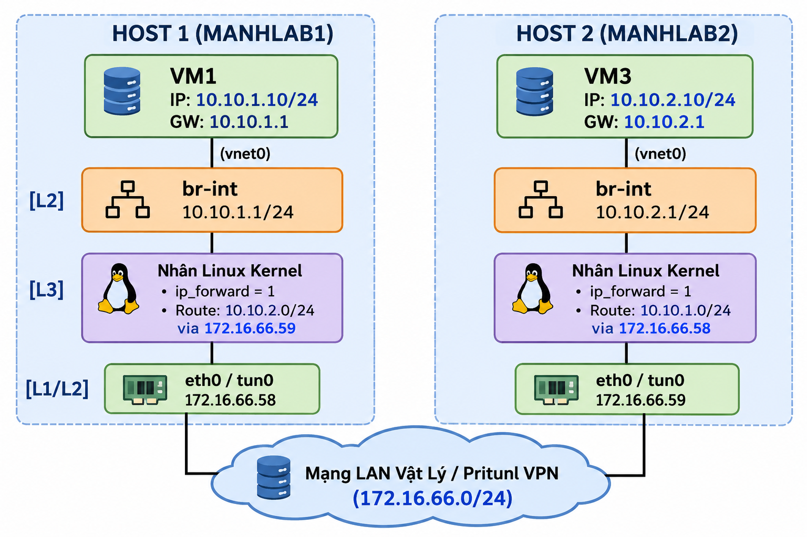
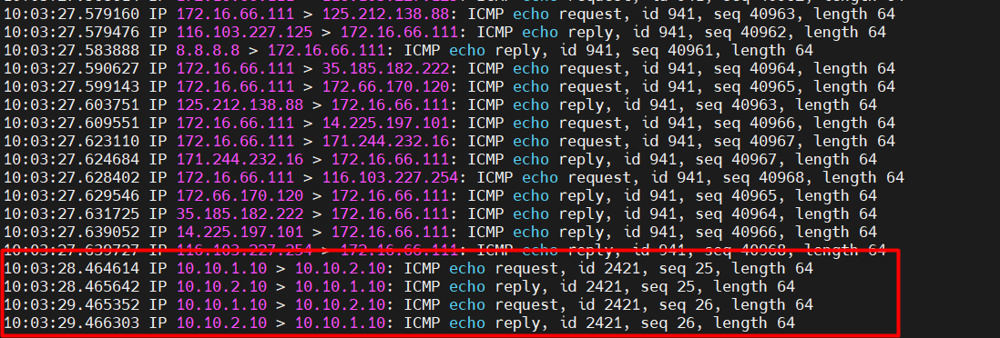

# Lab vSwitch và Linux Bridge 
## Mục tiêu bài LAB
- Phân tích vSwitch mặc định của KVM (virbr0 - NAT).
- Xây dựng một Private vSwitch (Cô lập hoàn toàn) kết nối VM2 và VM4, qua đó quan sát cơ chế học địa chỉ MAC (FDB - Forwarding Database).
- Xây dựng một Public vSwitch (Bridge với card vật lý) để đưa VM1 ra cùng dải mạng 172.16.66.x với KVM Host.

## vSwitch mặc định (virbr0-NAT)
Theo mặc định, khi được cài đặt, Libvirt sẽ tạo ra 1 Linux Bridge mặc định là virbr0 hoạt động ở chế độ NAT.
```
root@manh-lab-01:~# ip link show type bridge
3: virbr0: <BROADCAST,MULTICAST,UP,LOWER_UP> mtu 1500 qdisc noqueue state UP mode DEFAULT group default qlen 1000
    link/ether 52:54:00:c4:9b:f5 brd ff:ff:ff:ff:ff:ff
```

Kiểm tra các cổng interface đang cắm vào mạng `virbr0`
```
root@manh-lab-01:~# bridge link show
15: vnet4: <BROADCAST,MULTICAST,UP,LOWER_UP> mtu 1500 master virbr0 state forwarding priority 32 cost 2
17: vnet6: <BROADCAST,MULTICAST,UP,LOWER_UP> mtu 1500 master virbr0 state forwarding priority 32 cost 2
18: vnet7: <BROADCAST,MULTICAST,UP,LOWER_UP> mtu 1500 master virbr0 state forwarding priority 32 cost 2
```
Bạn sẽ thấy các thiết bị có tiền tố vnet (ví dụ vnet0, vnet1). Đây chính là các cổng ảo (TAP interfaces) nối từ máy ảo (VM1, VM2, VM4) vào switch `virbr0`

Kiểm tra cấp phát dhcp:
```
root@manh-lab-01:~# ps aux | grep dnsmasq
libvirt+   41507  0.0  0.0  11496  2220 ?        S    Oct30   0:00 /usr/sbin/dnsmasq --conf-file=/var/lib/libvirt/dnsmasq/default.conf --leasefile-ro --dhcp-script=/usr/lib/libvirt/libvirt_leaseshelper
root       41508  0.0  0.0  11496  1580 ?        S    Oct30   0:00 /usr/sbin/dnsmasq --conf-file=/var/lib/libvirt/dnsmasq/default.conf --leasefile-ro --dhcp-script=/usr/lib/libvirt/libvirt_leaseshelper
root       84721  0.0  0.0   6548  2304 pts/4    S+   08:49   0:00 grep --color=auto dnsmasq
```
vSwitch `virbr0` không chỉ là Switch L2 mà còn được Libvirt gắn thêm một tiến trình dnsmasq để cấp IP cho các máy ảo cắm vào nó.
```
root@manh-lab-01:~# virsh net-dhcp-leases default
 Expiry Time           MAC address         Protocol   IP address           Hostname   Client ID or DUID
------------------------------------------------------------------------------------------------------------------------------------------------
 2026-11-04 09:22:02   52:54:00:7d:aa:08   ipv4       192.168.122.192/24   -          01:52:54:00:7d:aa:08
 2026-11-04 09:20:44   52:54:00:9a:e6:72   ipv4       192.168.122.46/24    -          01:52:54:00:9a:e6:72
 2026-11-04 09:36:14   52:54:00:b6:d1:c9   ipv4       192.168.122.78/24    ubuntu     ff:56:50:4d:98:00:02:00:00:ab:11:25:5d:4b:4b:1f:92:51:4a
```
## Xây dựng Private vSwitch và Phân tích MAC Learning (FDB)
Chúng ta sẽ tạo một Switch Layer 2 hoàn toàn cô lập tên là br-private, chỉ dùng để kết nối VM2 và VM4 với nhau. Switch này không cắm ra card mạng vật lý, không có Internet

Tạo Private Bridge bằng Libvirt XML. 
- Tạo file `/tmp/private-net.xml` nội dung như sau
```
<network>
  <name>private-net</name>
  <bridge name='br-private' stp='off' delay='0'/>
</network>
```
- Apply và khởi chạy mạng
```
virsh net-define /tmp/private-net.xml
virsh net-start private-net
virsh net-autostart private-net
```
- Kiểm tra: Ở đây chúng ta sẽ thấy Linux Kernel vừa tạo ra một switch ảo L2 mới
```
root@manh-lab-01:~# ip a | grep br-private
19: br-private: <NO-CARRIER,BROADCAST,MULTICAST,UP> mtu 1500 qdisc noqueue state DOWN group default qlen 1000
```
Cắm dây mạng từ VM2 và VM4 vào vSwitch mới
- Tách card mạng hiện tại và cắm card mới vào private-net
```
# Gắn card cho VM2
virsh attach-interface --domain vm2 --type network --source private-net --model virtio --config --live

# Gắn card cho VM4
virsh attach-interface --domain vm4 --type network --source private-net --model virtio --config --live
```
- Truy cập vào VM2 và VM4 để gán IP. Ví dụ VM2, tương tự với VM4
```
# Truy cập vào console vm2
root@manh-lab-01:~# virsh console vm2
Connected to domain 'vm2'
Escape character is ^] (Ctrl + ])

root@ubuntu:~#

# Kiểm tra các card mạng, ở đây sẽ thấy card mạng enp7s0 là mạng vừa tạo
root@ubuntu:~# ip link show
1: lo: <LOOPBACK,UP,LOWER_UP> mtu 65536 qdisc noqueue state UNKNOWN mode DEFAULT group default qlen 1000
    link/loopback 00:00:00:00:00:00 brd 00:00:00:00:00:00
2: enp1s0: <BROADCAST,MULTICAST,UP,LOWER_UP> mtu 1500 qdisc fq_codel state UP mode DEFAULT group default qlen 1000
    link/ether 52:54:00:b6:d1:c9 brd ff:ff:ff:ff:ff:ff
3: enp7s0: <BROADCAST,MULTICAST> mtu 1500 qdisc noop state DOWN mode DEFAULT group default qlen 1000
    link/ether 52:54:00:4d:28:08 brd ff:ff:ff:ff:ff:ff

# Gán IP 
root@ubuntu:~# sudo ip addr add 10.10.10.2/24 dev enp7s0
root@ubuntu:~# sudo ip link set enp7s0 up

# Kiểm tra lại
root@ubuntu:~# ip a show enp7s0
3: enp7s0: <BROADCAST,MULTICAST,UP,LOWER_UP> mtu 1500 qdisc fq_codel state UP group default qlen 1000
    link/ether 52:54:00:4d:28:08 brd ff:ff:ff:ff:ff:ff
    inet 10.10.10.2/24 scope global enp7s0
       valid_lft forever preferred_lft forever
    inet6 fe80::5054:ff:fe4d:2808/64 scope link
       valid_lft forever preferred_lft forever
```
- Bật chế độ giám sát MAC (FDB) trên Terminal khác của Host1
```
watch -n 1 bridge fdb show br br-private
```
- Ở VM2 thực hiện Ping sang vm4
- Ở chế độ giám sát MAC, chúng ta sẽ thấy Linux Bridge bắt được địa chỉ MAC
```
52:54:00:4d:28:08 dev vnet8 master br-private
fe:54:00:4d:28:08 dev vnet8 vlan 1 master br-private permanent
fe:54:00:4d:28:08 dev vnet8 master br-private permanent
33:33:00:00:00:01 dev vnet8 self permanent
01:00:5e:00:00:01 dev vnet8 self permanent
33:33:ff:4d:28:08 dev vnet8 self permanent
52:54:00:0a:eb:03 dev vnet9 master br-private
fe:54:00:0a:eb:03 dev vnet9 vlan 1 master br-private permanent
fe:54:00:0a:eb:03 dev vnet9 master br-private permanent
```
Ta vừa thấy được `br-private` hoạt động chuẩn như một Switch vật lý: Học địa chỉ MAC Nguồn, ghi vào bảng FDB, và đẩy Frame ra đúng cổng của MAC Đích

## Định tuyến giữa 2 KVM Host
Làm sao để vm1 ở Host 1 có thể giao tiếp tới vm3 ở Host 2?

Mục tiêu:
- Chuyển đổi vai trò của MANHLAB1 và MANHLAB2 từ những máy chủ KVM Host đơn thuần thành các Router mềm (Software Router).
- Thiết lập đường truyền thông suốt ở Tầng 3 (Layer 3) giữa 2 máy ảo (VM1 và VM3) khác dải mạng và nằm trên 2 Host cách biệt.

Mô hình



Phân tích:
- Từ VM1 (`10.10.1.10`): Tạo gói tin ICMP với Source = `10.10.1.10`, Destination = `10.10.2.10`. Đích đến khác dải mạng, VM1 đẩy gói tin lên Default Gateway (`10.10.1.1`).
- Tại Host 1 (br-int): Gói tin đi qua cổng ảo vnet0 và đi vào bridge br-int của MANHLAB1.
- Tại Host 1 (Routing): Nhân Linux của MANHLAB1 nhận gói tin. Nó kiểm tra bảng định tuyến, thấy luật: "Muốn đến `10.10.2.0/24` thì ném qua `172.16.66.59`". Host 1 lập tức đẩy gói tin ra card vật lý (eth0), giữ nguyên 100% IP Source và Destination.
- Qua mạng LAN: Gói tin băng qua môi trường mạng vật lý (hoặc VPN) để tới MANHLAB2.
- Tại Host 2 (Routing): MANHLAB2 (`172.16.66.59`) nhận được gói tin. Nhân Linux kiểm tra đích đến là `10.10.2.10`. Nó biết IP này thuộc về subnet đang gắn trực tiếp trên `br-int` của nó.
- Tới VM3: Host 2 đẩy gói tin vào br-int, truyền qua Tầng 2 (chuyển đổi MAC) và đưa đích xác vào VM3.
- Quá trình Reply: VM3 gửi lại gói trả lời, luồng đi diễn ra đối xứng theo chiều ngược lại nhờ bảng Route trên Host 2.


Thực hiện trên Host 1:
```
# 1. Tạo Linux Bridge và gán IP Gateway cho VM1
sudo ip link add br-int type bridge
sudo ip addr add 10.10.1.1/24 dev br-int
sudo ip link set br-int up

# 2. Bật IP Forwarding và cho phép chuyển tiếp gói tin
sudo sysctl -w net.ipv4.ip_forward=1
sudo iptables -P FORWARD ACCEPT

# 3. Thêm Static Route: Muốn đến mạng của VM3 thì đi qua IP của Host 2
sudo ip route add 10.10.2.0/24 via 172.16.66.59

# 4. Đăng ký mạng này với Libvirt để cắm vào VM
cat > /tmp/int-net.xml <<EOF
<network>
  <name>int-net</name>
  <forward mode='bridge'/>
  <bridge name='br-int'/>
</network>
EOF

# 5. Khai báo và bật mạng
virsh net-define /tmp/int-net.xml
virsh net-start int-net
```
- Kiểm tra với ip route, sẽ thấy một dòng route mới chỉ đích danh mạng `10.10.2.0/24` đi qua gateway `172.16.66.59`
```
root@manh-lab-01:/etc/netplan# ip route
default via 172.16.66.1 dev ens160 proto static
10.10.1.0/24 dev br-int proto kernel scope link src 10.10.1.1 linkdown
10.10.2.0/24 via 172.16.66.59 dev ens160
```
Cấu hình trên Host 2
```
# 1. Tạo Linux Bridge và gán IP Gateway cho VM3
sudo ip link add br-int type bridge
sudo ip addr add 10.10.2.1/24 dev br-int
sudo ip link set br-int up

# 2. Bật IP Forwarding
sudo sysctl -w net.ipv4.ip_forward=1
sudo iptables -P FORWARD ACCEPT

# 3. Thêm Static Route: Muốn đến mạng của VM1 thì đi qua IP của Host 1
sudo ip route add 10.10.1.0/24 via 172.16.66.58

# 4. Đăng ký mạng với Libvirt
cat > /tmp/int-net.xml <<EOF
<network>
  <name>int-net</name>
  <forward mode='bridge'/>
  <bridge name='br-int'/>
</network>
EOF

# 5. Khai báo và bật mạng
virsh net-define /tmp/int-net.xml
virsh net-start int-net
```
- Kiểm tra với ip route, sẽ thấy có đường đi tới `10.0.0.2/24 via 172.16.66.58`
```
root@manh-lab-02:~# ip route
default via 172.16.66.1 dev ens160 proto static
10.10.1.0/24 via 172.16.66.58 dev ens160
10.10.2.0/24 dev br-int proto kernel scope link src 10.10.2.1 linkdown
```
Gán mạng vào vm
```
# Host 1 - vm1
virsh attach-interface --domain vm1 --type network --source int-net --model virtio --config --live

# Host 2 - vm3
virsh attach-interface --domain vm3 --type network --source int-net --model virtio --config --live
```
Vào console gán IP và bật mạng, ví dụ VM1. Tương tự với VM3
```
ip addr add 10.10.1.10/24 dev eth1
ip link set eth1 up
ip route add default via 10.10.1.1
```

