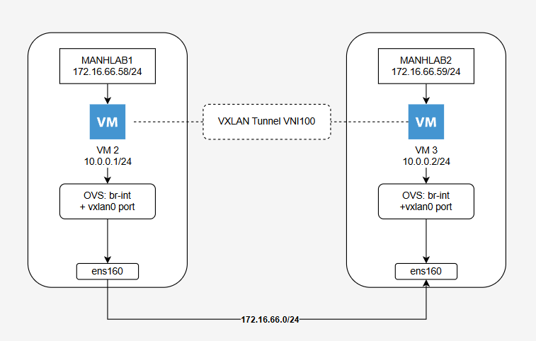
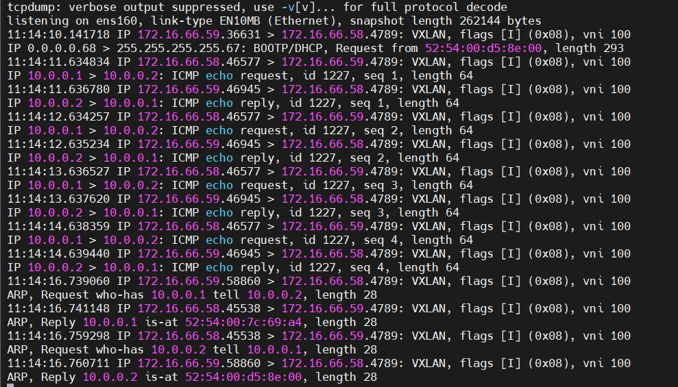

# Lab OVS VXLAN
## ! Một số câu lệnh cơ bản thao tác với OVS

### 1. Open vSwitch Daemon Commands
- Dùng để điều khiển toàn hệ thống OVS.
- Công cụ chính: ovs-vsctl (tương tác với ovs-vswitchd).
- Hiển thị toàn bộ bridge, port, interface trong OVS.

```bash
# Kiểm tra cấu hình hiện tại
sudo ovs-vsctl show
```

### 2. Bridge Commands
- Dùng để quản lý virtual switch (bridge).
```bash
# Tạo bridge mới
sudo ovs-vsctl add-br br0

# Xóa bridge
sudo ovs-vsctl del-br br0

# Xem danh sách bridge
sudo ovs-vsctl list-br
```

### 3. Port Commands
- Quản lý cổng (port) được gắn vào bridge.
```bash
# Thêm port vật lý ens33 vào br0
sudo ovs-vsctl add-port br0 ens33

# Thêm port nội bộ (internal)
sudo ovs-vsctl add-port br0 br0-int -- set interface br0-int type=internal

# Xóa port
sudo ovs-vsctl del-port br0 ens33

# Liệt kê port của bridge
sudo ovs-vsctl list-ports br0
```

### 4. Interface Commands
- Quản lý interface gắn với port.
```bash
# Liệt kê tất cả interfaces
sudo ovs-vsctl list interface

# Xem chi tiết interface cụ thể
sudo ovs-vsctl list interface ens33
```

### 5. Database Commands
- OVS sử dụng `ovsdb-server` để lưu trữ cấu hình trong dạng database.
- Các table chính: `Bridge`, `Port`, `Interface`, `Open_vSwitch`, `Flow_Table`...

```bash
# Liệt kê tất cả bảng trong database
sudo ovs-vsctl list-tables

# Liệt kê record trong bảng Bridge
sudo ovs-vsctl list Bridge

# Hiển thị chi tiết record theo cột
sudo ovs-vsctl list interface name,type

# Tìm kiếm record có name=br0 trong bảng Bridge
sudo ovs-vsctl find Bridge name=br0
```   

## Mục tiêu bài Lab
Thực hành OVS & VXLAN: Biết tạo OVS Bridge và mở đường ống VXLAN (Overlay Tunnel) nối 2 KVM Host vật lý

Nối Layer 2 qua mạng Layer 3: Giúp các VM ở 2 host khác nhau giao tiếp trực tiếp như cắm chung một Switch (cùng Subnet/VLAN, gửi gói ARP/Broadcast bình thường)

Nền tảng Cloud & SDN: Hiểu cơ chế bọc gói tin (Encapsulation) – kiến thức gốc rễ phục vụ OpenStack, Kubernetes CNI và di chuyển VM (Live Migration) giữ nguyên IP

## Mô hình


Host 1: **Ubuntu** - `172.16.66.58` - VM2: `10.0.1.1`

Host 2: **Ubuntu** - `172.16.66.59` - VM3: `10.0.1.2`

VXLAN VNI: 100, UDP port: 4789

Mô tả:
- Đối với 2 VM, trông như chúng đang giao tiếp trong cùng 1 dải `10.0.0.0/24`
- Nhưng bản chất gói tin được đóng gói -> đi qua ens160 -> qua card vật lý -> qua ens160 -> bóc tách -> tới vm3

Ta có thể thấy được rõ ràng bản chất 2 lớp mạng:
- Lớp vật lý bên dưới (Underlay) gánh chịu lưu lượng truyền tải.
- Lớp ảo hóa bên trên (Overlay) tạo không gian mạng L2 cho các máy ảo

## Thực hành
### Cài đặt OVS và cấu hình VXLAN trên cả 2 Host
Cài đặt OVS:
```
sudo apt update && sudo apt install openvswitch-switch -y
```
Kiểm tra:
```
root@manh-lab-01:~# ovs-vsctl show
7f9f957d-20fd-41c5-b9cf-b4715805e95f
    Bridge br-int
        Port br-int
            Interface br-int
                type: internal
    ovs_version: "3.3.9"
```
Tạo OVS bridge
```
sudo ovs-vsctl add-br br-int
```
Tạo cổng VXLAN `vxlan0`:
```
# Host1
sudo ovs-vsctl add-port br-int vxlan0 -- set interface vxlan0 type=vxlan options:remote_ip=172.16.66.59 options:key=100

# Host2
sudo ovs-vsctl add-port br-int vxlan0 -- set interface vxlan0 type=vxlan options:remote_ip=172.16.66.58 options:key=100
``` 
Kiểm tra:
```bash
16: br-int: <BROADCAST,MULTICAST> mtu 1500 qdisc noop state DOWN group default qlen 1000
    link/ether 56:f3:ef:8d:40:4d brd ff:ff:ff:ff:ff:ff
17: vxlan_sys_4789: <BROADCAST,MULTICAST,UP,LOWER_UP> mtu 65000 qdisc noqueue master ovs-system state UNKNOWN group default qlen 1000
    link/ether ee:65:53:40:da:d1 brd ff:ff:ff:ff:ff:ff
    inet6 fe80::e8d4:b6ff:fe37:cca5/64 scope link
       valid_lft forever preferred_lft forever
```
### Khai báo Network trong libvirt
Thực hiện lần lượt trên Host 1 và Host 2
- Tạo file cấu hình XML `ovs-net.xml`:
```xml
cat <<EOF > ovs-net.xml
<network>
  <name>ovs-br-int</name>
  <forward mode='bridge'/>
  <bridge name='br-int'/>
  <virtualport type='openvswitch'/>
</network>
EOF
```
- Khởi tạo và kích hoạt mạng
```
virsh net-define ovs-net.xml
virsh net-start ovs-br-int
virsh net-autostart ovs-br-int
```
- Kiểm tra:
```bash
root@manh-lab-02:~# virsh net-list --all
 Name         State    Autostart   Persistent
-----------------------------------------------
 default      active   yes         yes
 ovs-br-int   active   yes         yes
```
### Kết nối máy ảo vào OVS Network
Thực hiện lần lượt trên 2 VM ở 2 Host
- Gỡ mạng default ở VM2 ở Host 1
```bash
root@manh-lab-01:~# virsh domiflist vm2
 Interface   Type      Source    Model    MAC
-------------------------------------------------------------
 vnet2       network   default   virtio   52:54:00:b6:d1:c9

root@manh-lab-01:~# virsh detach-interface --domain vm2 --type network --mac 52:54:00:b6:d1:c9 --config --live
Interface detached successfully
```
- Gắn `vm2` vào mạng `ovs-br-int`:
```bash
virsh attach-interface --domain vm2 --type network --source ovs-br-int --model virtio --config --live
```
- Kiểm tra:
```bash
root@manh-lab-01:~# virsh domiflist vm2
 Interface   Type     Source       Model    MAC
---------------------------------------------------------------
 vnet6       bridge   ovs-br-int   virtio   52:54:00:7c:69:a4
```
Tương tự với VM3 ở Host 2
```bash
# Lấy địa chỉ MAC
root@manh-lab-02:~# virsh domiflist vm3
 Interface   Type      Source    Model    MAC
-------------------------------------------------------------
 vnet5       network   default   virtio   52:54:00:e4:71:c2

# Gỡ mạng
root@manh-lab-02:~# virsh detach-interface --domain vm3 --type network --mac 52:54:00:e4:71:c2 --config --live
Interface detached successfully

# Gán mạng
root@manh-lab-02:~# virsh attach-interface --domain vm3 --type network --source ovs-br-int --model virtio --config --live
Interface attached successfully

# Kiểm tra
root@manh-lab-02:~# virsh domiflist vm3
 Interface   Type     Source       Model    MAC
---------------------------------------------------------------
 vnet6       bridge   ovs-br-int   virtio   52:54:00:d5:8e:00
```
### Gán IP và kiểm tra kết nối L2
Host 1:
- Truy cập vào VM2 trên Host 1:
```
virsh console vm2
``` 
- Gán IP và bật mạng
```bash
ip addr add 10.0.0.1/24 dev enp1s0
ip link set dev enp1s0 up
```
Host 2:
- Truy cập vào VM3 trên Host 2:
```
virsh console vm3
```
- Gán IP và bật mạng
```
ip addr add 10.0.0.2/24 dev enp1s0
ip link set dev enp1s0 up
```
Kiểm tra:
- Kiểm tra với ping
```
root@ubuntu:~# ping -c 4 10.0.0.2
PING 10.0.0.2 (10.0.0.2) 56(84) bytes of data.
64 bytes from 10.0.0.2: icmp_seq=1 ttl=64 time=6.84 ms
64 bytes from 10.0.0.2: icmp_seq=2 ttl=64 time=1.91 ms
64 bytes from 10.0.0.2: icmp_seq=3 ttl=64 time=1.85 ms
64 bytes from 10.0.0.2: icmp_seq=4 ttl=64 time=1.81 ms

--- 10.0.0.2 ping statistics ---
4 packets transmitted, 4 received, 0% packet loss, time 3005ms
rtt min/avg/max/mdev = 1.814/3.103/6.838/2.156 ms
```
- Kiểm tra bảng ARP
```
root@ubuntu:~# ip neighbor
10.0.0.2 dev enp1s0 lladdr 52:54:00:d5:8e:00 REACHABLE
```
### Bắt gói tin với tcpdump
Listen trên card ens160, UDP, cổng 4789
```
sudo tcpdump -i ens160 udp port 4789 -n
```
Kết quả:



Bạn sẽ thấy các gói UDP Port 4789 trao đổi giữa IP `172.16.66.58` và `172.16.66.59`

## So sánh với cách dùng Routing
### So sánh luồng xử lý gói tin (Data Flow)
Với bài lab VXLAN / OVS (Layer 2):
- vm1 (`10.0.0.11`) muốn gửi tin cho vm3 (`10.0.0.13`).
- vm1 phát gói tin ARP Request "Who has `10.0.0.13`?" (Broadcast).
- OVS trên Host 1 bắt gói Broadcast này, bọc thêm header VXLAN (VNI 100) rồi gửi dạng Unicast sang IP của Host 2 (`172.16.66.59`).
- OVS trên Host 2 tháo header VXLAN và thả gói ARP nguyên bản ra port của vm3.
- vm1 và vm3 thấy nhau trực tiếp ở Layer 2 như đang cắm chung một Switch vật lý.

Với bài toán Định tuyến (Layer 3):
- vm1 (`10.0.1.11/24`) muốn gửi tin cho vm3 (`10.0.2.13/24`).
- vm1 nhận thấy `10.0.2.13` khác Subnet nên gửi gói tin đến Default Gateway của nó 
- Host 1 tiếp nhận gói tin, tra bảng định tuyến (ip route) để xem dải `10.0.2.0/24` đi đường nào
- Host 1 thực hiện Routing: sửa lại Destination MAC trong Ethernet Header thành MAC của Host 2 rồi đẩy gói IP sang Host 2.
- Host 2 nhận gói tin ở Layer 3 và chuyển tiếp (forward) nội bộ vào giao diện mạng của vm3.

### Khi nào dùng mô hình nào?
Dùng VXLAN (Layer 2 Overlay):

- Cần triển khai các hệ thống Cloud/Multi-tenant (OpenStack, VMware NSX).
- Cần tính năng Live Migration máy ảo giữa các node vật lý mà không làm gián đoạn IP.
- Các ứng dụng cluster bắt buộc chạy chung L2 (dùng multicast, Keepalived/VRRP, heartbeat).

Dùng Định tuyến L3 (Layer 3 Routing):
- Thiết kế mạng Data Center quy mô lớn (mô hình Spine-Leaf / BGP).
- Cần tối ưu hiệu năng và băng thông, tránh tình trạng bão Broadcast (Broadcast Storm) lan tràn giữa các máy chủ.
- Mạng Kubernetes CNI chạy dạng L3 pure-routing (như Calico / Flannel host-gw) để đạt throughput cao nhất mà không bị tốn overhead đóng gói VXLAN.