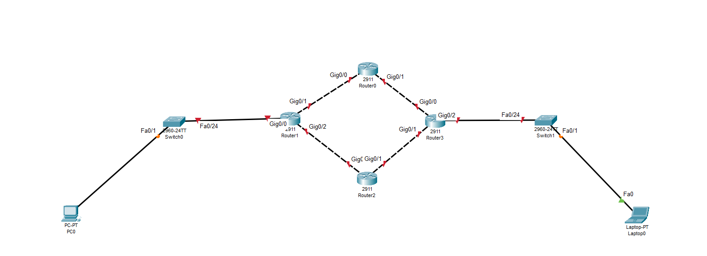
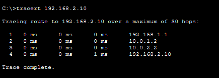
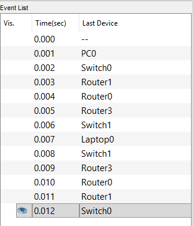

# Cấu hình Static Routing trên Cisco Packet Tracer

## 1. Mô tả Hệ thống & Quy hoạch Mạng

### 1.1. Kiến trúc tổng quan
Hệ thống mô phỏng kết nối liên mạng giữa hai chi nhánh thông qua hạ tầng lõi gồm 4 bộ định tuyến xếp theo mô hình hình thoi (`Router1`, `Router0`, `Router2`, `Router3`), tạo thành **2 tuyến đường vật lý song song** (nhánh trên qua `Router0` và nhánh dưới qua `Router2`):



* **Thiết bị đầu cuối (End Devices):** 01 máy tính để bàn (`PC0`) tại mạng LAN trái và 01 máy tính xách tay (`Laptop0`) tại mạng LAN phải.
* **Thiết bị chuyển mạch (Layer 2 Switches):** 02 Switch **Cisco 2960-24TT** (`Switch0`, `Switch1`). Hoạt động ở tầng 2 với cấu hình mặc định (tất cả cổng mở sẵn và thuộc VLAN 1), không cần gán IP hay cấu hình thêm.
* **Thiết bị định tuyến (Routers):** 04 Router **Cisco 2911**, mỗi thiết bị có sẵn 3 cổng `GigabitEthernet` (`Gi0/0`, `Gi0/1`, `Gi0/2`), bố trí theo vị trí hình học:
  * **`Router1`:** Router biên bên trái (kết nối mạng LAN trái).
  * **`Router0`:** Router trung chuyển nhánh trên (đỉnh hình thoi).
  * **`Router2`:** Router trung chuyển nhánh dưới (đáy hình thoi).
  * **`Router3`:** Router biên bên phải (kết nối mạng LAN phải).

### 1.2. Phân chia dải mạng (6 Subnets)

| Dải mạng (Subnet) | Mô tả | Các thiết bị tham gia |
| :--- | :--- | :--- |
| `192.168.1.0/24` | Mạng LAN chi nhánh trái | `PC0` – `Switch0` – `Router1 (Gi0/0)` |
| `192.168.2.0/24` | Mạng LAN chi nhánh phải | `Router3 (Gi0/2)` – `Switch1` – `Laptop0` |
| `10.0.1.0/30` | Liên kết điểm–điểm nhánh trên trái | `Router1 (Gi0/1)` – `Router0 (Gi0/0)` |
| `10.0.2.0/30` | Liên kết điểm–điểm nhánh trên phải | `Router0 (Gi0/1)` – `Router3 (Gi0/0)` |
| `10.0.4.0/30` | Liên kết điểm–điểm nhánh dưới trái | `Router1 (Gi0/2)` – `Router2 (Gi0/0)` |
| `10.0.3.0/30` | Liên kết điểm–điểm nhánh dưới phải | `Router2 (Gi0/1)` – `Router3 (Gi0/1)` |

### 1.3. Bảng quy hoạch đấu nối và địa chỉ IP chi tiết

| Thiết bị | Cổng (Interface) | Địa chỉ IP | Subnet Mask | Default Gateway | Đấu nối tới | Loại cáp |
| :--- | :--- | :--- | :--- | :--- | :--- | :--- |
| **PC0** | `FastEthernet0` | `192.168.1.10` | `255.255.255.0` | `192.168.1.1` | `Switch0 (Fa0/1)` | Cáp thẳng |
| **Switch0** | `Fa0/1`, `Fa0/24` | *(Không gán IP)* | *(Layer 2)* | *(Không có)* | `PC0`, `Router1 (Gi0/0)` | Cáp thẳng |
| **Router1** *(Trái)* | `Gi0/0` | `192.168.1.1` | `255.255.255.0` | *(Không có)* | `Switch0 (Fa0/24)` | Cáp thẳng |
| **Router1** *(Trái)* | `Gi0/1` | `10.0.1.1` | `255.255.255.252` | *(Không có)* | `Router0 (Gi0/0)` | Cáp chéo |
| **Router1** *(Trái)* | `Gi0/2` | `10.0.4.2` | `255.255.255.252` | *(Không có)* | `Router2 (Gi0/0)` | Cáp chéo |
| **Router0** *(Trên)* | `Gi0/0` | `10.0.1.2` | `255.255.255.252` | *(Không có)* | `Router1 (Gi0/1)` | Cáp chéo |
| **Router0** *(Trên)* | `Gi0/1` | `10.0.2.1` | `255.255.255.252` | *(Không có)* | `Router3 (Gi0/0)` | Cáp chéo |
| **Router2** *(Dưới)* | `Gi0/0` | `10.0.4.1` | `255.255.255.252` | *(Không có)* | `Router1 (Gi0/2)` | Cáp chéo |
| **Router2** *(Dưới)* | `Gi0/1` | `10.0.3.2` | `255.255.255.252` | *(Không có)* | `Router3 (Gi0/1)` | Cáp chéo |
| **Router3** *(Phải)* | `Gi0/0` | `10.0.2.2` | `255.255.255.252` | *(Không có)* | `Router0 (Gi0/1)` | Cáp chéo |
| **Router3** *(Phải)* | `Gi0/1` | `10.0.3.1` | `255.255.255.252` | *(Không có)* | `Router2 (Gi0/1)` | Cáp chéo |
| **Router3** *(Phải)* | `Gi0/2` | `192.168.2.1` | `255.255.255.0` | *(Không có)* | `Switch1 (Fa0/24)` | Cáp thẳng |
| **Switch1** | `Fa0/1`, `Fa0/24` | *(Không gán IP)* | *(Layer 2)* | *(Không có)* | `Laptop0`, `Router3 (Gi0/2)` | Cáp thẳng |
| **Laptop0** | `FastEthernet0` | `192.168.2.10` | `255.255.255.0` | `192.168.2.1` | `Switch1 (Fa0/1)` | Cáp thẳng |

## 2. Mô tả Bài Lab & Mục tiêu

### 2.1. Mô tả bài lab
Thực hành kỹ thuật định tuyến tĩnh (**Static Routing**) trên hệ điều hành Cisco IOS. Vì các Router chỉ tự động nhận biết các mạng cắm trực tiếp vào cổng của nó (*Directly Connected*), kỹ sư mạng phải cấu hình thủ công các tuyến đường tĩnh trên từng Router để thông suốt lưu lượng hai chiều giữa `PC0` và `Laptop0`, đồng thời khai thác cấu trúc mạch vòng hình thoi để triển khai dự phòng và cân bằng tải.

### 2.2. Mục tiêu
1. **Giai đoạn 0 (Hạ tầng & Kiểm tra kết nối trực tiếp):** Cắm đúng cổng vật lý, đặt IP và thông mạng toàn bộ các chặng cắm trực tiếp (1-hop).
2. **Trường hợp 1 (Static Routing cơ bản):** Định tuyến tĩnh 2 chiều để `PC0` và `Laptop0` giao tiếp qua nhánh chính phía trên (`Router1` $\leftrightarrow$ `Router0` $\leftrightarrow$ `Router3`).
3. **Trường hợp 2 (Floating Static Route — Dự phòng tự động):** Cấu hình tuyến dự phòng qua nhánh dưới (`Router2`) với chỉ số **Administrative Distance (AD) = 5**. Khi đứt cáp nhánh trên, hệ thống tự động chuyển hướng sang nhánh dưới.
4. **Trường hợp 3 (Static ECMP Load Balancing — Cân bằng tải):** Đặt đồng mức ưu tiên (**AD = 1**) cho cả 2 nhánh để chia tải lưu lượng song song qua cả `Router0` và `Router2`.

## 3. Thực hành

### 3.1. Đấu nối cáp & Cấu hình IP cơ bản

#### Bước 1: Bật hiển thị tên cổng & Đấu nối cáp chính xác
1. Trên thanh menu Packet Tracer, chọn **Options $\rightarrow$ Preferences $\rightarrow$ Interface** $\rightarrow$ tích chọn **Always Show Port Labels in Logical Workspace** rồi đóng cửa sổ.
2. **Không dùng dây tự động (hình tia sét).** Hãy chọn thủ công dây **Copper Straight-Through** (nét liền đen) và **Copper Cross-Over** (nét đứt đen) rồi click chọn **đúng tên cổng** theo Bảng 1.3.
   * *Kiểm tra:* Nhìn trên sơ đồ đảm bảo các nhãn `Gi0/0`, `Gi0/1`, `Gi0/2` ở hai đầu dây khớp hoàn toàn với sơ đồ ở Mục 1.1.

#### Bước 2: Đặt IP cho PC0 và Laptop0
1. Click vào **PC0 $\rightarrow$ tab Desktop $\rightarrow$ IP Configuration**, chọn **Static** và điền:
   * **IPv4 Address:** `192.168.1.10`
   * **Subnet Mask:** `255.255.255.0`
   * **Default Gateway:** `192.168.1.1`
2. Click vào **Laptop0 $\rightarrow$ tab Desktop $\rightarrow$ IP Configuration**, chọn **Static** và điền:
   * **IPv4 Address:** `192.168.2.10`
   * **Subnet Mask:** `255.255.255.0`
   * **Default Gateway:** `192.168.2.1`

#### Bước 3: Đặt IP các cổng trên 4 Router
Mở tab **CLI** của từng Router (nếu hiện câu hỏi `initial configuration dialog? [yes/no]:`, gõ `no` rồi nhấn **Enter**), copy từng khối lệnh và bấm nút **Paste** ở góc dưới bên phải cửa sổ CLI:

* **Trên Router1:**
```ios
enable
configure terminal
hostname Router1
!
interface GigabitEthernet0/0
 description LAN_TRAI
 ip address 192.168.1.1 255.255.255.0
 no shutdown
!
interface GigabitEthernet0/1
 description TO_ROUTER0
 ip address 10.0.1.1 255.255.255.252
 no shutdown
!
interface GigabitEthernet0/2
 description TO_ROUTER2
 ip address 10.0.4.2 255.255.255.252
 no shutdown
end
```

* **Trên Router0:**
```ios
enable
configure terminal
hostname Router0
!
interface GigabitEthernet0/0
 description TO_ROUTER1
 ip address 10.0.1.2 255.255.255.252
 no shutdown
!
interface GigabitEthernet0/1
 description TO_ROUTER3
 ip address 10.0.2.1 255.255.255.252
 no shutdown
end
```

* **Trên Router2:**
```ios
enable
configure terminal
hostname Router2
!
interface GigabitEthernet0/0
 description TO_ROUTER1
 ip address 10.0.4.1 255.255.255.252
 no shutdown
!
interface GigabitEthernet0/1
 description TO_ROUTER3
 ip address 10.0.3.2 255.255.255.252
 no shutdown
end
```

* **Trên Router3:**
```ios
enable
configure terminal
hostname Router3
!
interface GigabitEthernet0/0
 description TO_ROUTER0
 ip address 10.0.2.2 255.255.255.252
 no shutdown
!
interface GigabitEthernet0/1
 description TO_ROUTER2
 ip address 10.0.3.1 255.255.255.252
 no shutdown
!
interface GigabitEthernet0/2
 description LAN_PHAI
 ip address 192.168.2.1 255.255.255.0
 no shutdown
end
```

#### Bước 4: Kiểm tra xác nhận Giai đoạn 0 (Bắt buộc trước khi định tuyến)
1. Bấm nút **Fast Forward Time (`Alt + D`)** 1–2 lần để Switch hoàn tất khởi động cổng. Toàn bộ hình tam giác trên dây nối phải chuyển sang **màu xanh lá**.
2. Gõ lệnh `show ip interface brief` trên từng Router: tất cả các cổng đã gán IP phải có cột `Status` = **`up`** và `Protocol` = **`up`**.
```
Router1#show ip interface brief
Interface              IP-Address      OK? Method Status                Protocol 
GigabitEthernet0/0     192.168.1.1     YES manual up                    up 
GigabitEthernet0/1     10.0.1.1        YES manual up                    up 
GigabitEthernet0/2     10.0.4.2        YES manual up                    up 
Vlan1                  unassigned      YES unset  administratively down down
Router1#
```
3. Kiểm tra ping các điểm nối trực tiếp (nếu bước này lỗi thì dừng lại kiểm tra cổng cắm):
   * Từ **PC0** (`Command Prompt`): gõ `ping 192.168.1.1` $\rightarrow$ Phải thành công (`Reply from 192.168.1.1`).
   * Từ **Laptop0** (`Command Prompt`): gõ `ping 192.168.2.1` $\rightarrow$ Phải thành công (`Reply from 192.168.2.1`).
   * Từ CLI của **Router1**: gõ `ping 10.0.1.2` và `ping 10.0.4.1` $\rightarrow$ Phải hiện `!!!!!` (tỷ lệ 100%).

### 3.2. Trường hợp 1: Static Routing cơ bản (Tuyến đơn nhánh trên)

#### Bước 1: Nhập lệnh định tuyến tĩnh 2 chiều
Cú pháp: `ip route <Mạng_Đích> <Subnet_Mask> <IP_Cổng_Kế_Tiếp>`

* **Trên Router1** (trỏ tới mạng LAN phải `192.168.2.0/24` và mạng trung chuyển `10.0.2.0/30` qua cổng `10.0.1.2` của `Router0`):
```ios
configure terminal
ip route 192.168.2.0 255.255.255.0 10.0.1.2
ip route 10.0.2.0 255.255.255.252 10.0.1.2
end
```

* **Trên Router0** (trạm trung chuyển ở giữa, phải biết đường sang cả 2 đầu LAN):
```ios
configure terminal
ip route 192.168.2.0 255.255.255.0 10.0.2.2
ip route 192.168.1.0 255.255.255.0 10.0.1.1
end
```

* **Trên Router3** (trỏ chiều về cho mạng LAN trái `192.168.1.0/24` và mạng `10.0.1.0/30` qua cổng `10.0.2.1` của `Router0`):
```ios
configure terminal
ip route 192.168.1.0 255.255.255.0 10.0.2.1
ip route 10.0.1.0 255.255.255.252 10.0.2.1
end
```

*(Lưu ý: `Router2` chưa cấu hình gì ở Trường hợp 1).*

#### Bước 2: Kiểm tra kết quả & Xem gói tin di chuyển
1. **Kiểm tra qua dòng lệnh:** Mở **PC0 $\rightarrow$ Desktop $\rightarrow$ Command Prompt**, gõ:
   ```cmd
   ping 192.168.2.10
   tracert 192.168.2.10
   ```
   * *Kết quả đạt chuẩn:* `ping` thông 4/4 gói (gói đầu tiên có thể mất 1–2 giây để hỏi ARP). `tracert` hiện đúng 4 chặng: `192.168.1.1` $\rightarrow$ `10.0.1.2` $\rightarrow$ `10.0.2.2` $\rightarrow$ `192.168.2.10`.
   
   
2. **Xem trực quan đường đi gói tin (Simulation Mode):**
   * Nhấn vào tab **Simulation** ở góc dưới bên phải màn hình.
   * Bấm nút **Show All/None** rồi chọn **Edit Filters** $\rightarrow$ chỉ tích chọn **ICMP**
   * Bấm biểu tượng phong bì thư **Add Simple PDU (P)** ở thanh công cụ bên phải $\rightarrow$ click vào **PC0**, sau đó click vào **Laptop0**.
   * Bấm nút **Capture / Forward** liên tiếp: bạn sẽ thấy gói tin chạy từ `PC0` $\rightarrow$ `Switch0` $\rightarrow$ `Router1` $\rightarrow$ `Router0` $\rightarrow$ `Router3` $\rightarrow$ `Switch1` $\rightarrow$ `Laptop0` và quay ngược lại theo đúng nhánh trên.
   * Xong việc, chuyển lại về chế độ **Realtime** ở góc dưới bên phải.
   * 

### 3.3. Trường hợp 2: Floating Static Route (Dự phòng tự động qua nhánh dưới)

#### Bước 1: Cấu hình tuyến dự phòng với AD = 5
Tuyến tĩnh mặc định qua `Router0` có độ ưu tiên **AD = 1**. Ta thêm tuyến qua `Router2` với **AD = 5** (số càng lớn độ ưu tiên càng thấp, chỉ kích hoạt khi tuyến AD = 1 bị đứt).

* **Trên Router2** (khai báo định tuyến 2 chiều để sẵn sàng chuyển tiếp):
```ios
configure terminal
ip route 192.168.2.0 255.255.255.0 10.0.3.1
ip route 192.168.1.0 255.255.255.0 10.0.4.2
end
```

* **Trên Router1** (thêm tuyến dự phòng qua `10.0.4.1` của `Router2` với AD = `5`):
```ios
configure terminal
ip route 192.168.2.0 255.255.255.0 10.0.4.1 5
end
```

* **Trên Router3** (thêm tuyến dự phòng chiều về qua `10.0.3.2` của `Router2` với AD = `5`):
```ios
configure terminal
ip route 192.168.1.0 255.255.255.0 10.0.3.2 5
end
```

#### Bước 2: Giả lập đứt cáp & Kiểm tra chuyển mạch dự phòng
1. **Trước khi đứt cáp:** Gõ `show ip route` trên `Router1`, chỉ thấy tuyến `S 192.168.2.0/24 [1/0] via 10.0.1.2`.
2. **Ngắt kết nối nhánh trên:** Vào CLI của **Router0**, tắt cổng `Gi0/0`:
   ```ios
   configure terminal
   interface GigabitEthernet0/0
    shutdown
   end
   ```
3. **Xác nhận tự động chuyển tuyến:**
   * Gõ `show ip route` trên `Router1`: tuyến cũ biến mất, tuyến dự phòng lập tức xuất hiện: `S 192.168.2.0/24 [5/0] via 10.0.4.1`.
   * Vào **Command Prompt** của `PC0`, gõ `tracert 192.168.2.10` $\rightarrow$ Đường đi tự động chuyển xuống nhánh dưới: `192.168.1.1` $\rightarrow$ `10.0.4.1` (`Router2`) $\rightarrow$ `10.0.3.1` (`Router3`) $\rightarrow$ `192.168.2.10`.
4. **Khôi phục nhánh trên**: Vào CLI của **Router0**, bật lại cổng `Gi0/0`:
   ```ios
   configure terminal
   interface GigabitEthernet0/0
    no shutdown
   end
   ```
### 3.4. Trường hợp 3: Static ECMP Load Balancing (Cân bằng tải 2 nhánh)

#### Bước 1: Đưa cả 2 tuyến về cùng mức ưu tiên AD = 1
* **Trên Router1** (xóa tuyến AD `5` và thêm lại với AD mặc định `1`):
```ios
configure terminal
no ip route 192.168.2.0 255.255.255.0 10.0.4.1 5
ip route 192.168.2.0 255.255.255.0 10.0.4.1
end
```

* **Trên Router3** (xóa tuyến AD `5` và thêm lại với AD mặc định `1`):
```ios
configure terminal
no ip route 192.168.1.0 255.255.255.0 10.0.3.2 5
ip route 192.168.1.0 255.255.255.0 10.0.3.2
end
```

#### Bước 2: Kiểm tra cân bằng tải song song
1. Gõ `show ip route` trên `Router1`, bảng định tuyến hiển thị đồng thời 2 Next-hop cùng chỉ số `[1/0]`:
   ```text
   S    192.168.2.0/24 [1/0] via 10.0.1.2
                       [1/0] via 10.0.4.1
   ```
2. Chuyển sang chế độ **Simulation**, dùng **Add Simple PDU (P)** gửi liên tiếp 2 gói tin từ `PC0` sang `Laptop0` rồi bấm **Capture / Forward**: gói tin thứ nhất đi qua nhánh trên (`Router0`) và gói tin thứ hai đi qua nhánh dưới (`Router2`).

## 4. Lưu cấu hình toàn bộ hệ thống

Trên cả 4 Router (`Router1`, `Router0`, `Router2`, `Router3`), chạy lệnh sau ở dấu nhắc `#` để lưu cấu hình vào bộ nhớ NVRAM trước khi tắt file `.pkt`:

```ios
write memory
```