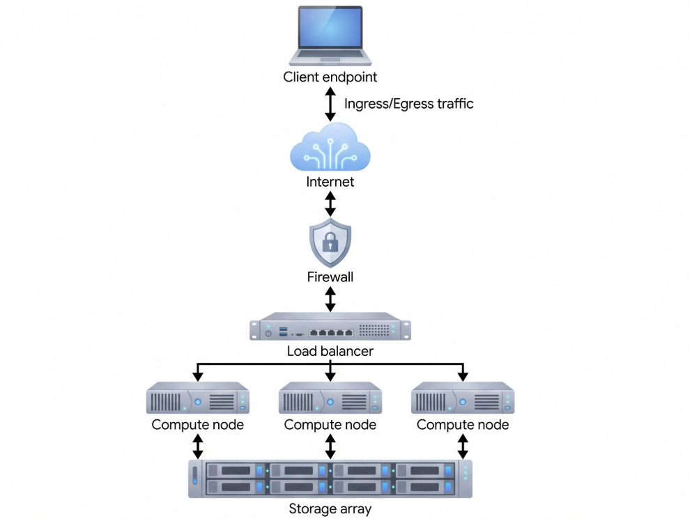

# Load Balancer (Bộ cân bằng tải)
Là 1 hệ thống định tuyến ngược (Reverse Proxy/ Traffic Director) đứng trước 1 cụm máy chủ ứng dụng, có nhiệm vụ tiếp nhận toàn bộ lưu lượng truy cập đến 1 điểm đầu cuối duy nhất và phân phối đều các yêu cầu đó xuống các máy chủ xử lý bên dưới dựa trên năng lực thực tế và trạng thái sức khỏe của từng máy

Trong mô hình trên, lưu lượng từ người dùng đi quả Firewall trước khi chạm tới Load Balancer, sau đó được chi đều xuống các Compute Node chạy song song.

Toàn bộ các Compute Node và đều phải kết nối chung về 1 hệ thống lưu trữ tập trung để đảm bảo dữ liệu đồng nhất bất kể yêu cầu của người dùng rơi vào node nào

# Cấu trúc
1 Load Balancer hoàn chỉnh được cấu thành từ 4 module cốt lõi:
- Frontend: Điểm tiếp nhận kết nối từ bên ngoài, gắn với 1 VIP và cổng dịch vụ cố định. Frontend chịu trách nhiệm quản lý các kết nối đến từ Client và áp dụng chính sách bảo mật
- Backend Pool: Danh sách các máy chủ thực tế đảm nhận việc xử lý nghiệp vụ, được định danh bằng địa chỉ IP nội bộ và cổng ứng dụng
- Health Check Engine: Module chạy ngầm liên tục để xác minh khả năng sống sót của từng Backend node, chia làm 2 cơ chế:
  - Active Health Check: Load Balancer chủ động gửi yêu cầu thăm dò định kỳ. Nếu 1 node trả về lỗi hoặc timeout liên tiếp N lần, node đó lập tức bị gạch khỏi danh sách nhận tải cho đến khi vượt qua bài kiểm tra phục hồi
  - Passive Health Check: Load Balancer theo dõi trực tiếp lưu lượng thật của người dùng. Nếu phát hiện 1 lỗi Backend liên tục trả về mã lỗi `502/503/504` hoặc ngắt kết nối đột ngột, nó tạm thời cô lập node đó trong 1 khoảng thời gian
- Connection & State Table: Vùng bộ nhớ RAM lưu trữ bảng ánh xạ các phiên kết nối đang mở, bộ đếm số lượng kết nối hiện tại trên từng node và thông tin định tuyến phiên

# Thuật toán điều phối tải
Quyết định đẩy yêu cầu tiếp theo vào máy chủ nào phụ thuộc vào thuật toán lập lịch được cấu hình trên Backend Pool
## Nhóm thuật toán tĩnh
- Round Robin: Phân phối yêu cầu tuần tự theo vòng tròn. Phù hợp khi các máy chủ có cấu hình phần cứng ngang ngang nhau và thời gian xử lý mỗi yêu cầu tương đương nhau
- Weighted Round Robin: Gán trọng số tương ứng với sức mạnh phần cứng của từng máy
- Modulo Hash: Tính hàm băm từ IP nguồn của Client hoặc đường dẫn URL, sau đó chia lấy dư cho tổng số máy chủ(hash(key) %N). Nhược điểm lớn nhất của thuật toán là khi thêm 1 máy chủ, gần như toàn bộ kết quả phép chia bị đảo lộn

## Nhóm thuật toán động
- Least Connections: Đẩy yêu cầu mới vào máy chủ đang có số lượng kết nối mở ít nhất
- Weighted Least Connections: Kết hợp giữa số lượng kết nối đang mở và trọng số phần cứng, chọn node có tỷ số thấp nhất
- Least Response Time: Đo thời gian phản hồi trung bình của từng node kết hợp với số kết nối hiện tại để chọn ra máy chủ phản hồi nhanh nhất
- Consistent Hashing: Tổ chức các máy chủ trên 1 vòng tròn, mỗi máy chủ vật lý được ánh xạ thành nhiều điểm ảo rải đều trên vòng tròn để tránh lệch tải. 

# Quản lý phiên
Mặc định LB cố gắng thiết kế hệ thống theo hướng Stateless. Tuy nhiên, với các ứng dụng cũ lưu giỏ hàng hoặc trạng thái đăng nhập trực tiếp trên RAM cục bộ của từng máy chủ, LB phải bật Sticky Session để ép toàn bộ yêu cầu của 1 người dùng luôn đi vào đúng 1 Backend node duy nhất:
- Cookie Insertion: Ở lần phản hồi đầu tiên, LB tự chèn thêm 1 HTTP Cookie định danh gửi về trình duyệt của Client
- Cookie Learning: LB đọc trực tiếp Session Cookie do chính ứng dụng sinh ra
- Source IP Affinity: Ghi nhớ cặp [Client IP -> Backend Node] trong 1 khoảng thời gian. Kém chính xác hơn Cookie vì nhiều người dùng cùng ngồi sau 1 mạng Wi-Fi công ty sẽ bị dồn hết vào 1 Backend node gây lệch tải

# Các kỹ thuật tối ưu hiệu năng và bảo vệ hệ thống
Trong môi trường Production, LB không chỉ chia tải mà còn đóng vai trò bộ đệm bảo vệ cụm Backend
- TLS/SSL Offloading: Việc bắt tay mã hóa và giải mã lưu lượng HTTPS tiêu tốn rất nhiều CPU. LB gánh toàn bộ việc giải mã chứng chỉ số tại cửa ngõ, sau đó giao tiếp với các Backend bên trong bằng kết nối nội bộ nhẹ hơn
- Connection Pooling: Thay vì cứ mỗi request của người dùng lại bắt Backend phải mở và đóng 1 kết nối mới, LB duy trì sẵn 1 bể kết nối bền vững tới các Backend. Hàng nghìn kết nối từ người dùng bên ngoài sẽ được dồn chung qua vài chục kết nối mở sẵn bên trong, giảm mạnh tải CPU và RAM cho Backend
- Rate Limiting: Chặn đứng các đợt bùng phát lưu lượng bất thường hoặc tấn công Brute-force bằng thuật toán Token Bucket hoặc Leaky Bucket
- Circuit Breaking: Khi 1 dịch vụ Backend bị chậm nghiêm trọng hoặc chạm ngưỡng tối đa hàng đợi kết nối, LB chủ động ngắt mạch thay vì cố nhồi thêm request khiến toàn bộ cụm máy chủ bị sập dây chuyền
- Graceful Drain: Khi cần nâng cấp phiên bản ứng dụng, qtv chuyển trạng thái node sang Drain. LB lập tức ngừng gửi kết nối mới vào node đó, nhưng vẫn giữ nguyên các kết nối cũ đang chạy cho đến khi người dùng hoàn tất rồi mới tắt ứng dụng