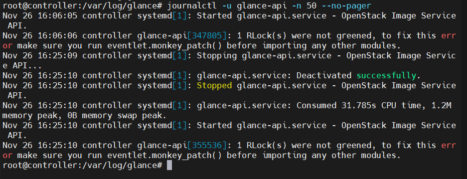

# Hệ thống Log & Gỡ lỗi OpenStack Glance (`/var/log/glance/`)

Tiếp nối phần cấu hình (`/etc/glance/glance-api.conf`), hệ thống **Log (Nhật ký)** là nguồn dữ liệu giám sát cốt lõi giúp bạn theo dõi trạng thái vận hành của dịch vụ **Glance**, truy vết từng yêu cầu upload/download image và khoanh vùng nhanh nguyên nhân khi phát sinh lỗi xác thực, kết nối cơ sở dữ liệu hoặc lưu trữ tệp.

## 1. Vị trí lưu trữ & các tệp Log của Glance

### 1.1. Trên hệ thống cài đặt thủ công từ gói Ubuntu (`controller` — `172.16.66.60`)

Mặc định, log của Glance được ghi vào thư mục **`/var/log/glance/`** dưới quyền sở hữu của tài khoản dịch vụ `glance:glance`:

| Tệp Log | Đường dẫn mặc định | Vai trò & Nội dung ghi nhận | 
| ----- | ----- | ----- | 
| **`glance-api.log`** | `/var/log/glance/glance-api.log` | **Tệp log quan trọng nhất:** Ghi lại toàn bộ HTTP request gửi tới cổng `9292`, quá trình xác thực token với Keystone, truy vấn metadata trên MariaDB và thao tác đọc/ghi tệp ảnh qua `glance_store`. | 
| **`glance-scrubber.log`** | `/var/log/glance/glance-scrubber.log` | Ghi nhận hoạt động của tiến trình dọn dẹp ngầm (`glance-scrubber`) khi bật tính năng xóa trì hoãn (*Delayed Delete* — dọn file vật lý sau khi image chuyển sang `pending_delete`). | 
| **`glance-registry.log`** | *(Không còn sử dụng)* | Chỉ tồn tại trên các phiên bản OpenStack cũ trước Queens/Stein khi `glance-registry` chưa bị loại bỏ. | 

Ngoài tệp log trực tiếp trong `/var/log/glance/`, trạng thái khởi động/dừng của tiến trình dịch vụ còn được ghi vào **systemd journal**:

```
journalctl -u glance-api -n 50 --no-pager
```



### 1.2. Lưu ý đối với môi trường DevStack (nếu tham chiếu từ Lab DevStack)

* Trên các bản DevStack hiện đại, `glance-api` thường chạy qua `uwsgi` dưới sự quản lý của `systemd` (`devstack@g-api.service`), nên log mặc định đổ vào **`journalctl`** (`journalctl -u devstack@g-api.service`) thay vì ghi trực tiếp ra `/var/log/glance/`.

* Nếu cần ép xuất log ra tệp riêng trong DevStack, phải tạo thư mục log thuộc quyền user chạy stack (`stack:stack`) và khai báo `log_dir` / `log_file` trong `/etc/glance/glance-api.conf` rồi khởi động lại `devstack@g-api.service`.

* **Trên môi trường cài đặt chuẩn (`controller` `172.16.66.60`):** Tuyệt đối giữ quyền thư mục log là **`glance:glance`** (`chown -R glance:glance /var/log/glance`), không dùng `stack:stack` vì dịch vụ `glance-api` chạy dưới user `glance`.

## 2. Cấu hình ghi Log trong `/etc/glance/glance-api.conf`

Các tham số điều khiển hành vi ghi log nằm trong section **`[DEFAULT]`** của tệp `/etc/glance/glance-api.conf`:

```
[DEFAULT]
log_dir = /var/log/glance
debug = False

```

### Giải thích các tham số quan trọng

* **`log_dir = /var/log/glance`:** Chỉ định thư mục chứa tệp log (`glance-api.log`). Khi đã đặt `log_dir`, Glance tự đặt tên file theo tên tiến trình nên thường **không cần** đặt thêm `log_file` (nếu đặt cả hai, `log_file` sẽ ưu tiên đường dẫn tệp cụ thể).

* **`debug = True | False`:**

  * `False` (mặc định vận hành): Ghi từ mức `INFO` trở lên (`INFO`, `WARNING`, `ERROR`, `CRITICAL`).

  * `True` (khi gỡ lỗi): Ghi thêm toàn bộ thông tin `DEBUG` (chi tiết header HTTP, luồng middleware, truy vấn SQL, đường dẫn file trên `glance_store`). **Lưu ý:** Chỉ bật tạm thời khi debug vì dung lượng tệp log sẽ tăng rất nhanh; sau khi xử lý xong hãy chuyển lại `False`.

* **Lưu ý về tham số `verbose`:** Trên các phiên bản OpenStack hiện đại (`oslo.log`), tham số `verbose` đã bị **deprecated** (mức `INFO` được bật mặc định khi `debug = False`), bạn không cần khai báo `verbose = True` nữa.

### Thao tác bật / tắt chế độ `debug` an toàn bằng `crudini`

```
# Bật debug khi cần soi lỗi chi tiết
crudini --set /etc/glance/glance-api.conf DEFAULT debug true
systemctl restart glance-api

# Tắt debug sau khi kiểm tra xong
crudini --set /etc/glance/glance-api.conf DEFAULT debug false
systemctl restart glance-api

```

## 3. Phân tích cấu trúc chi tiết một dòng Log chuẩn của Glance

Glance sử dụng thư viện **`oslo.log`**, do đó mọi dòng log đều tuân theo một định dạng chuẩn rất dễ đọc và truy vết. Xét ví dụ thực tế khi có một request gọi tới Glance API:

```
2026-11-26 16:45:12.170 2041 INFO eventlet.wsgi.server [req-7d876b1c-b2bd-4370-a5e0-d30233e37d9d 294c5c6181d442c68a13d5b615c4f031 5b4c1d2155004acf849cd3aac03b8f36 - default default] 172.16.66.60 - - [26/Nov/2026 16:45:12] "GET /v2/schemas/image HTTP/1.1" 200 6283 0.515541

```

### Bóc tách từng thành phần từ trái sang phải

| Thành phần trong dòng Log | Giá trị ví dụ | Ý nghĩa kỹ thuật | 
| ----- | ----- | ----- | 
| **Timestamp** | `2026-11-26 16:45:12.170` | Thời điểm ghi nhận sự kiện (chính xác tới mili-giây). | 
| **PID (Process ID)** | `2041` | Mã tiến trình worker của `glance-api` đang xử lý request. | 
| **Log Level** | `INFO` | Mức độ nghiêm trọng (`DEBUG`, `INFO`, `WARNING`, `ERROR`, `CRITICAL`). | 
| **Module / Logger** | `eventlet.wsgi.server` | Tên module Python phát sinh log (ví dụ `glance.api.v2.images`, `glance_store`, `keystonemiddleware.auth_token`). | 
| **Request-ID** | `req-7d876b1c-b2bd-4370-a5e0-d30233e37d9d` | **Mã định danh duy nhất của request.** Dùng mã này để gom toàn bộ các bước xử lý của cùng một hành động (kể cả khi truyền sang Nova/Keystone). | 
| **User ID** | `294c5c6181d442c68a13d5b615c4f031` | UUID của người dùng thực hiện yêu cầu (lấy từ token Keystone). | 
| **Project ID** | `5b4c1d2155004acf849cd3aac03b8f36` | UUID của project/tenant mà người dùng đang phạm vi hóa (*scoped*). | 
| **Global Request-ID** | `-` | Mã request toàn cục xuyên suốt nhiều dịch vụ (nếu được khởi tạo từ dịch vụ khác như Nova gọi sang Glance). | 
| **User & Project Domain** | `default default` | Tên domain của User và của Project (thường là `default`). | 
| **Client IP** | `172.16.66.60` | Địa chỉ IP nguồn gửi HTTP request tới cổng `9292`. | 
| **HTTP Method & URI** | `"GET /v2/schemas/image HTTP/1.1"` | Phương thức HTTP (`GET`, `POST`, `PUT`, `DELETE`) và đường dẫn API Glance v2 được gọi. | 
| **HTTP Status Code** | `200` | Mã phản hồi HTTP (`200`/`201`/`204` thành công; `401` lỗi xác thực; `403` từ chối quyền; `404` không tìm thấy; `500` lỗi nội bộ). | 
| **Response Size** | `6283` | Kích thước dữ liệu phản hồi tính theo byte. | 
| **Execution Time** | `0.515541` | Tổng thời gian xử lý request tính bằng giây (`~0.51s`). | 

## 4. Các lệnh theo dõi & bắt bệnh thực tế từ Log Glance

### 4.1. Giám sát trực tiếp (Real-time) khi thao tác Image

Mở một cửa sổ terminal khác trên `controller` (`172.16.66.60`) và chạy lệnh sau trước khi thực hiện `openstack image create ...`:

```
tail -f /var/log/glance/glance-api.log

```

### 4.2. Lọc nhanh các dòng lỗi (`ERROR` / `WARNING` / HTTP `4xx` / `5xx`)

```
grep -E "ERROR|CRITICAL|WARNING| 401 | 403 | 404 | 500 | 503 " /var/log/glance/glance-api.log | tail -n 30

```

### 4.3. Truy vết trọn vẹn một phiên làm việc theo `Request-ID`

Khi CLI trả về lỗi kèm mã `Request-ID` (ví dụ `req-7d876b1c-b2bd-4370-a5e0-d30233e37d9d`), lọc toàn bộ dòng log thuộc về đúng request đó:

```
grep "req-7d876b1c-b2bd-4370-a5e0-d30233e37d9d" /var/log/glance/glance-api.log

```

### 4.4. Bảng tra cứu nhanh các lỗi phổ biến trong `glance-api.log`

| Hiện tượng / Từ khóa trong Log | Nguyên nhân gốc | Hướng xử lý | 
| ----- | ----- | ----- | 
| `HTTP 401 Unauthorized` hoặc log từ `keystonemiddleware` báo `Unable to validate token` | Sai `username`, `password`, `project_name`, `auth_url` trong khối `[keystone_authtoken]` của `glance-api.conf`, hoặc user `glance` thiếu role `admin` trên project `service`. | Đối chiếu lại khối `[keystone_authtoken]` và kiểm tra bằng `openstack role assignment list --project service --user glance --names`. | 
| `pymysql.err.OperationalError` / `Access denied for user 'glance'` | Sai chuỗi `connection` trong `[database]` hoặc chưa chạy `glance-manage db_sync`. | Kiểm tra kết nối trực tiếp bằng `mysql -u glance -p28072003 -h 172.16.66.60 glance` và chạy lại `db_sync`. | 
| `PermissionError: [Errno 13] Permission denied: '/var/lib/glance/images/...'` | Thư mục lưu trữ `/var/lib/glance/images/` hoặc `/var/lib/glance/tmp` đang thuộc quyền `root:root` thay vì `glance:glance`. | Chạy `chown -R glance:glance /var/lib/glance` và khởi động lại `glance-api`. | 
| `500 Internal Server Error` kèm `No space left on device` | Phân vùng chứa `/var/lib/glance/images/` đầy dung lượng khi upload file ảnh lớn. | Kiểm tra `df -h /var/lib/glance/images/`, dọn dẹp hoặc mở rộng dung lượng/trỏ sang `filesystem_store_datadirs` khác. | 