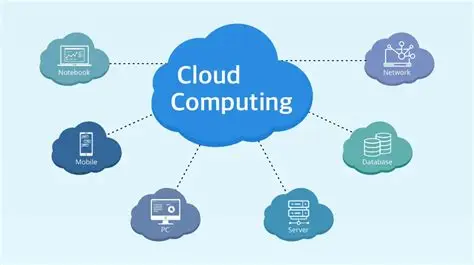

# Tổng quan về Điện toán đám mây (Cloud Computing)

## I. Điện toán đám mây là gì?
**Điện toán đám mây (Cloud Computing)** là mô hình cung cấp các tài nguyên máy tính (như máy chủ, không gian lưu trữ, mạng lưới, phần mềm, ứng dụng) thông qua Internet ("đám mây"). 

Thay vì phải mua sắm, cài đặt và bảo trì các hệ thống máy chủ vật lý hay ổ cứng phức tạp, bạn có thể thuê và truy cập mọi thứ qua Internet. Mục tiêu cốt lõi của Cloud là mang lại sự tiện lợi, dễ dàng mở rộng và tối ưu chi phí cho các dịch vụ công nghệ thông tin.

---

## II. Mô hình Cloud "5 - 3 - 4"
Để hiểu toàn diện về Cloud Computing, bạn chỉ cần nắm vững bộ khung gồm: **5 đặc điểm, 3 mô hình dịch vụ và 4 cách triển khai.**

### 1. Năm (05) Đặc điểm thiết yếu
Đây là những yếu tố bắt buộc phải có của bất kỳ hệ thống điện toán đám mây nào:
- **Tự phục vụ theo nhu cầu (On-demand self-service):** Người dùng chủ động cung cấp, quản lý, cài đặt và thay đổi cấu hình tài nguyên bất cứ lúc nào mà không cần sự can thiệp từ nhân viên của nhà cung cấp.
- **Truy cập mạng rộng rãi (Broad network access):** Dịch vụ luôn sẵn sàng trên Internet. Bạn có thể truy cập, quản lý và sử dụng dữ liệu từ bất kỳ thiết bị nào (điện thoại, laptop, máy tính bảng) và từ bất kỳ đâu.
- **Dùng chung tài nguyên (Resource pooling):** Nhà cung cấp sử dụng một hệ thống hạ tầng khổng lồ để phục vụ nhiều khách hàng cùng lúc (Multi-tenant). Dù dùng chung phần cứng vật lý, dữ liệu và tài nguyên của mỗi khách hàng vẫn được tách biệt và bảo mật tuyệt đối.
- **Co giãn linh hoạt (Rapid elasticity):** Khả năng mở rộng (thêm tài nguyên khi cao điểm) hoặc thu hẹp (giảm tài nguyên khi không cần thiết) một cách nhanh chóng, thậm chí là tự động. 
- **Dịch vụ được đo lường (Measured service):** Hệ thống tự động giám sát, kiểm soát và tối ưu hóa việc sử dụng (lưu lượng mạng, dung lượng lưu trữ...). Nhờ đó, tính minh bạch được đảm bảo, khách hàng "dùng bao nhiêu, trả bấy nhiêu".

### 2. Ba (03) Mô hình dịch vụ
Mức độ kiểm soát hệ thống của bạn sẽ giảm dần từ IaaS xuống SaaS:
- **IaaS (Infrastructure as a Service - Hạ tầng như một dịch vụ):** 
  - **Khái niệm:** Nhà cung cấp cho bạn thuê cơ sở hạ tầng cốt lõi (máy chủ, mạng, lưu trữ). Bạn có toàn quyền cài đặt hệ điều hành và phần mềm tùy ý.
  - **Dễ hiểu:** Giống như bạn thuê một mảnh đất trống, sau đó tự do xây nhà theo ý mình.
- **PaaS (Platform as a Service - Nền tảng như một dịch vụ):**
  - **Khái niệm:** Nhà cung cấp chuẩn bị sẵn hạ tầng và môi trường (hệ điều hành, công cụ lập trình, cơ sở dữ liệu). Bạn chỉ cần tập trung vào việc tạo ra và quản lý ứng dụng của mình.
  - **Dễ hiểu:** Giống như bạn thuê một cửa hàng đã xây sẵn cơ bản trong trung tâm thương mại (như nền tảng bán hàng Tiki, Lazada), bạn chỉ cần dọn hàng hóa (ứng dụng) vào để kinh doanh.
- **SaaS (Software as a Service - Phần mềm như một dịch vụ):**
  - **Khái niệm:** Bạn sử dụng trực tiếp các ứng dụng hoàn chỉnh của nhà cung cấp qua trình duyệt web. Bạn không cần quan tâm đến máy chủ, hạ tầng hay việc cập nhật phần mềm.
  - **Ví dụ:** Gmail, Microsoft Office 365, Google Drive.

### 3. Bốn (04) Mô hình triển khai
Dựa trên đối tượng sử dụng và vị trí đặt dữ liệu, Cloud được chia thành 4 loại:
- **Public Cloud (Đám mây công cộng):** Hạ tầng do nhà cung cấp bên thứ 3 (AWS, Google, Microsoft) sở hữu và cho nhiều người, nhiều tổ chức cùng thuê qua Internet. Dễ sử dụng, chi phí rẻ.
- **Private Cloud (Đám mây lai/nội bộ):** Hạ tầng được sở hữu và sử dụng độc quyền bởi một tổ chức duy nhất (có thể đặt tại công ty hoặc thuê trung tâm dữ liệu). Ưu điểm là tính bảo mật và quyền kiểm soát cao nhất.
- **Community Cloud (Đám mây cộng đồng):** Hạ tầng được chia sẻ giữa một nhóm các tổ chức có chung mục tiêu, lĩnh vực hoặc yêu cầu bảo mật (ví dụ: cộng đồng các bệnh viện hoặc các cơ quan chính phủ).
- **Hybrid Cloud (Đám mây lai):** Sự kết hợp giữa Public Cloud và Private Cloud. Tổ chức có thể giữ dữ liệu nhạy cảm ở Private Cloud, nhưng đẩy các ứng dụng không quá quan trọng ra Public Cloud để tiết kiệm chi phí và tăng khả năng chịu tải.
